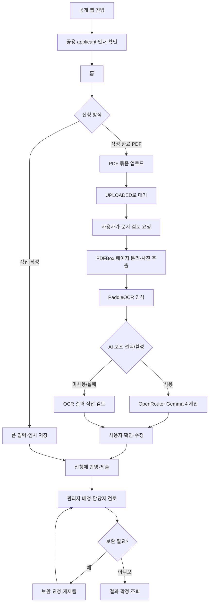

# 현재 업무 흐름도

갱신일: 2026-10-26 · 초기 설계 흐름은 [archive/02-initial.md](archive/02-initial.md)에 보존했다.

## 신청자 문서 처리

기존 PNG/JPEG 직접 첨부 경로도 지원한다. `/demo`와 공개 SC-00 체험은 제공하지 않는다. `PREPARED` 결과 재생은 저장된 결과를 보여주며 실제 OCR 호출로 계산하지 않는다.

## 상태와 유지관리

업로드 직후 `UPLOADED`; 명시적 요청 후 `QUEUED`/`PROCESSING`; 분석 완료 `READY`; 신청 반영 `APPLIED`; 실패 `FAILED`. 공개 공용 계정 자료는 KST 매일 04시 초기화된다. content-addressed 파일은 참조 여부에 따라 재사용하거나 orphan 수거한다.
