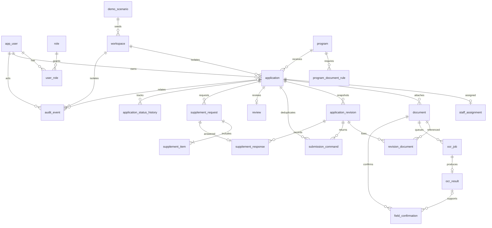
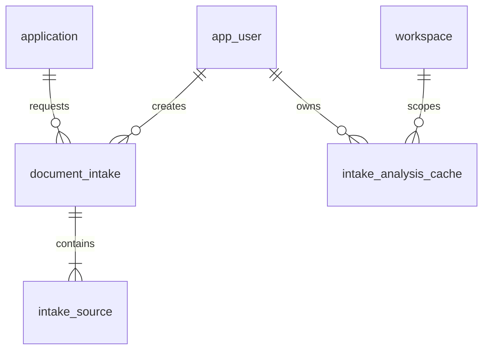

# DB 설계서 — ERD 및 테이블·컬럼 정의서

> **현재 스키마:** MariaDB 11.4 기준 Flyway V1–V12, MyBatis Mapper XML을 사용한다(JPA 아님). 기존 초기 ERD·정의는 아래에 보존된 설계 기준이며 실제 스키마는 migration DDL이 기준이다. 초기 본문 사본: [archive/05-initial.md](archive/05-initial.md).

### 현행 마이그레이션 및 문서 검토 테이블

| 버전 | 변경 |
|---|---|
| V1–V6 | 신청·사용자·검토 기본 스키마와 인덱스/포트폴리오 회차 |
| V7 | `document_intake`, `intake_source` 생성 |
| V8 | `request_key`, `request_hash`, 신청별 요청키 UNIQUE |
| V9 | `UPLOADED` 상태와 기본값 추가 |
| V10 | 파일 저장키 비고유 인덱스, 신청 정리 인덱스, `intake_analysis_cache` |
| V11 | `execution_mode` (`LIVE`/`PREPARED`), `replay_started_at` |
| V12 | LIVE 만료 작업 인덱스 |

`document_intake`: id PK, application_id/created_by FK, layout(BUNDLE/SEPARATE), status(UPLOADED/QUEUED/PROCESSING/READY/APPLIED/FAILED), stage/detail/progress(0–100), result_json/error_code, claim_token/lease_until, request_key/request_hash, execution_mode/replay_started_at, created_at/updated_at. 주요 인덱스는 application_id+id, status+id, application_id+request_key UNIQUE, execution_mode+status+lease_until+id다. `intake_source`: intake_id FK, kind, original_name, storage_key, mime_type, size_bytes(1–10MiB)이며 intake_id로 연결된다. `intake_analysis_cache` PK는 workspace_id+owner_id+request_hash+pipeline_version이며 payload/created_at을 저장한다. 상세 제약은 `src/main/resources/db/migration/V7__document_intake.sql`–`V12__live_intake_expiry_index.sql`을 따른다.

## 1. 명칭과 기준

이 산출물은 데이터베이스 설계서다. 논리·물리 ERD, 테이블 정의서, 컬럼 정의서, 키·제약·인덱스 설계를 포함한다. 물리 DDL은 `src/main/resources/db/migration/V1__support_schema.sql`, 추가 정렬 인덱스는 `V2__application_query_indexes.sql`에 구현했다. 아래 정의는 설계 기준안이므로 실제 컬럼·제약의 최종 기준은 마이그레이션 SQL이다. 기본 DB는 MariaDB, 엔진 InnoDB, 문자셋 utf8mb4, 모든 시각은 UTC DATETIME(6), 업무 엔티티 PK는 BIGINT를 기본으로 사용하며 코드·연결 테이블은 예외다. 기존 로컬 검증은 MariaDB 11.4.13을 사용했으며 Compose는 11.4 이미지 digest를 고정한다. collation은 이 문서에서 추가 확정하지 않는다. Oracle 호환성은 미검증이다.

## 2. 관계도

역할·작성자 등 반복 FK의 일부 선은 가독성을 위해 생략했다. 물리 FK는 아래 컬럼 정의를 기준으로 한다.

### 현행 문서검토 ERD 관계

기존 ERD는 초기 신청/OCR 설계다. 현재 문서 검토 흐름의 물리 관계와 변경 순서는 위 관계도 및 V7–V12 DDL로 보완한다.

## 3. 테이블 목록과 한글 명칭

| 물리 테이블명 | 한글 명칭 |
|---|---|
| app_user / role / user_role | 사용자 / 역할 / 사용자 역할 연결 |
| workspace / demo_scenario | 운영·체험 공간 / 예시 시나리오 |
| program / program_document_rule | 사업 공고 / 필수 서류 규칙 |
| application / staff_assignment | 신청 / 담당자 배정 |
| document | 첨부서류 버전 |
| application_revision / revision_document | 제출본 / 제출본 첨부 연결 |
| submission_command | 중복 제출 방지 요청 |
| ocr_job / ocr_result / field_confirmation | 문자 인식 작업 / 추출 결과 / 사용자 확인값 |
| review | 담당자 검토 |
| supplement_request / supplement_item / supplement_response | 보완 요청 / 요청 항목 / 보완 응답 |
| application_status_history / audit_event | 신청 상태 이력 / 처리·접근 감사 이력 |

## 4. 컬럼 정의

N=NULL 불가, Y=NULL 허용. UK의 복합 구성은 5절 기준이다.

### 01. app_user

| 컬럼 | MariaDB 타입 | NULL | 키 | 설명 |
| --- | --- | --- | --- | --- |
| id | BIGINT | N | PK | 자동 증가 |
| login_id | VARCHAR(100) | N | UK | 로그인 식별자 |
| password_hash | VARCHAR(255) | N |  | 원문 저장 금지 |
| display_name | VARCHAR(50) | N |  | 표시명 |
| status | VARCHAR(20) | N |  | ACTIVE/LOCKED |
| created_at | DATETIME(6) | N |  | UTC |

### 02. role

| 컬럼 | MariaDB 타입 | NULL | 키 | 설명 |
| --- | --- | --- | --- | --- |
| code | VARCHAR(20) | N | PK | APPLICANT/STAFF/ADMIN |
| name | VARCHAR(50) | N |  | 역할명 |

### 03. user_role

| 컬럼 | MariaDB 타입 | NULL | 키 | 설명 |
| --- | --- | --- | --- | --- |
| user_id | BIGINT | N | PK,FK app_user |  |
| role_code | VARCHAR(20) | N | PK,FK role | 복합 PK |

### 04. demo_scenario

| 컬럼 | MariaDB 타입 | NULL | 키 | 설명 |
| --- | --- | --- | --- | --- |
| id | BIGINT | N | PK |  |
| code | VARCHAR(30) | N | UK | NORMAL/MISMATCH/MISSING/SUPPLEMENT/OCR_FAIL |
| fixture_version | VARCHAR(30) | N |  | 가상 데이터 버전 |
| description | VARCHAR(500) | N |  | 예상 동작 |

### 05. workspace

| 컬럼 | MariaDB 타입 | NULL | 키 | 설명 |
| --- | --- | --- | --- | --- |
| id | BIGINT | N | PK | 운영 공간도 명시적 행 사용 |
| kind | VARCHAR(20) | N |  | NORMAL/DEMO |
| session_token_hash | CHAR(64) | Y | UK | DEMO만 필수, 원문 세션 ID 금지 |
| scenario_id | BIGINT | Y | FK demo_scenario | DEMO만 필수 |
| expires_at | DATETIME(6) | Y |  | DEMO만 필수, 운영은 NULL |
| created_at | DATETIME(6) | N |  | UTC |

### 06. program

| 컬럼 | MariaDB 타입 | NULL | 키 | 설명 |
| --- | --- | --- | --- | --- |
| id | BIGINT | N | PK |  |
| title | VARCHAR(200) | N |  | 공고명 |
| body | TEXT | N |  | 최대 10000자 |
| status | VARCHAR(20) | N |  | DRAFT/PUBLISHED/CLOSED |
| opens_at | DATETIME(6) | N |  | UTC |
| closes_at | DATETIME(6) | N |  | opens_at보다 큼 |
| max_amount | DECIMAL(12,0) | N |  | 양수, 원 |
| version | BIGINT | N |  | 낙관적 잠금 |
| created_at | DATETIME(6) | N |  | UTC |

### 07. program_document_rule

| 컬럼 | MariaDB 타입 | NULL | 키 | 설명 |
| --- | --- | --- | --- | --- |
| id | BIGINT | N | PK |  |
| program_id | BIGINT | N | FK program |  |
| type_code | VARCHAR(30) | N |  | BUSINESS_CERT/ESTIMATE |
| required | BOOLEAN | N |  | 필수 여부 |
| max_bytes | BIGINT | N |  | 10485760 |
| allowed_mime | VARCHAR(100) | N |  | image/png,image/jpeg |

### 08. application

| 컬럼 | MariaDB 타입 | NULL | 키 | 설명 |
| --- | --- | --- | --- | --- |
| id | BIGINT | N | PK |  |
| workspace_id | BIGINT | N | FK workspace | 모든 조회 격리 기준 |
| program_id | BIGINT | N | FK program |  |
| owner_id | BIGINT | N | FK app_user |  |
| application_round | INT | N | 복합 UK | V6, 기본 1. 개발용 applicant 계정의 반복 신청 회차 |
| receipt_no | VARCHAR(40) | Y | UK | 최초 제출 시 생성 |
| status | VARCHAR(30) | N |  | 정의한 6종 상태 |
| business_name | VARCHAR(100) | Y |  | 초안 NULL 허용 |
| business_no | CHAR(10) | Y |  | 가상 번호 |
| representative | VARCHAR(50) | Y |  | 대표자 |
| opened_on | DATE | Y |  | 개업일 |
| phone | VARCHAR(20) | Y |  | 연락처 |
| plan_text | TEXT | Y |  | 최대 2000자 |
| requested_amount | DECIMAL(12,0) | Y |  | 정수 원화 |
| submitted_at | DATETIME(6) | Y |  | 최초 제출 시각 |
| updated_at | DATETIME(6) | N |  | UTC |
| version | BIGINT | N |  | 원자적 증가 |

### 09. staff_assignment

| 컬럼 | MariaDB 타입 | NULL | 키 | 설명 |
| --- | --- | --- | --- | --- |
| id | BIGINT | N | PK |  |
| application_id | BIGINT | N | UK,FK application | 현재 배정 1건 |
| staff_id | BIGINT | N | FK app_user | STAFF 역할 검사 |
| assigned_by | BIGINT | N | FK app_user | ADMIN 검사 |
| reason | VARCHAR(1000) | N |  | 이관 포함 |
| assigned_at | DATETIME(6) | N |  | 이전 내역은 audit_event |

### 10. document

| 컬럼 | MariaDB 타입 | NULL | 키 | 설명 |
| --- | --- | --- | --- | --- |
| id | BIGINT | N | PK |  |
| application_id | BIGINT | N | FK application |  |
| type_code | VARCHAR(30) | N |  | 서류 종류 |
| version | INT | N |  | 종류별 증가 |
| storage_key | VARCHAR(255) | N | UK | 서버 생성 키 |
| original_name | VARCHAR(255) | N |  | 표시용, 경로 사용 금지 |
| mime_type | VARCHAR(100) | N |  | 시그니처 검사 결과 |
| size_bytes | BIGINT | N |  | 1~10485760 |
| sha256 | CHAR(64) | N |  | 파일 해시 |
| created_by | BIGINT | N | FK app_user |  |
| created_at | DATETIME(6) | N |  | 불변 파일 |

### 11. application_revision

| 컬럼 | MariaDB 타입 | NULL | 키 | 설명 |
| --- | --- | --- | --- | --- |
| id | BIGINT | N | PK |  |
| application_id | BIGINT | N | FK application |  |
| revision_no | INT | N |  | 1부터 증가 |
| snapshot | JSON | N |  | 버전 스키마 명시, 제출 정보·확인값 |
| submitted_by | BIGINT | N | FK app_user |  |
| submitted_at | DATETIME(6) | N |  | 불변 |

### 12. revision_document

| 컬럼 | MariaDB 타입 | NULL | 키 | 설명 |
| --- | --- | --- | --- | --- |
| revision_id | BIGINT | N | PK,FK application_revision |  |
| document_id | BIGINT | N | PK,FK document | 동일 신청 귀속 검사 |

### 13. submission_command

| 컬럼 | MariaDB 타입 | NULL | 키 | 설명 |
| --- | --- | --- | --- | --- |
| id | BIGINT | N | PK |  |
| application_id | BIGINT | N | FK application |  |
| idempotency_key | VARCHAR(64) | N |  | 클라이언트 생성 |
| payload_hash | CHAR(64) | N |  | 동일 키 다른 내용 409 |
| revision_id | BIGINT | N | FK application_revision | 재요청 결과 반환 |

### 14. ocr_job

| 컬럼 | MariaDB 타입 | NULL | 키 | 설명 |
| --- | --- | --- | --- | --- |
| id | BIGINT | N | PK |  |
| document_id | BIGINT | N | FK document | 불변 문서 버전 |
| provider_mode | VARCHAR(10) | N |  | SAMPLE/LIVE |
| provider_version | VARCHAR(50) | N |  | 공급자·모델 설정 식별 |
| status | VARCHAR(20) | N |  | PENDING/RUNNING/SUCCEEDED/FAILED |
| attempts | INT | N |  | 0~3 |
| next_attempt_at | DATETIME(6) | N |  | 대기 작업 |
| lease_until | DATETIME(6) | Y |  | RUNNING 시 필수 |
| claim_token | VARCHAR(64) | Y |  | 완료 갱신 소유자 확인 |
| error_code | VARCHAR(50) | Y |  | 민감 응답 제외 |
| created_at | DATETIME(6) | N |  | UTC |

### 15. ocr_result

| 컬럼 | MariaDB 타입 | NULL | 키 | 설명 |
| --- | --- | --- | --- | --- |
| id | BIGINT | N | PK |  |
| job_id | BIGINT | N | UK,FK ocr_job | 멱등 결과 |
| extracted_fields | JSON | N |  | 4개 항목 |
| confidence | JSON | Y |  | 항목별 제공 시만 |
| created_at | DATETIME(6) | N |  | UTC, 원문 응답 기본 미보관 |

### 16. field_confirmation

| 컬럼 | MariaDB 타입 | NULL | 키 | 설명 |
| --- | --- | --- | --- | --- |
| id | BIGINT | N | PK |  |
| document_id | BIGINT | N | FK document |  |
| ocr_result_id | BIGINT | Y | FK ocr_result | 수동 확인은 NULL |
| field_code | VARCHAR(30) | N |  | 4개 항목 중 하나 |
| confirmed_value | VARCHAR(200) | N |  | 최종 확인값 |
| confirmed_by | BIGINT | N | FK app_user |  |
| confirmed_at | DATETIME(6) | N |  | 제출 시 snapshot 보존 |

### 17. review

| 컬럼 | MariaDB 타입 | NULL | 키 | 설명 |
| --- | --- | --- | --- | --- |
| id | BIGINT | N | PK |  |
| application_id | BIGINT | N | UK,FK application | 현재 검토 |
| reviewer_id | BIGINT | N | FK app_user | 현재 배정 검사 |
| check_items | JSON | N |  | 서류·내용 검토 |
| decision | VARCHAR(20) | Y |  | APPROVED/REJECTED |
| reason | VARCHAR(1000) | Y |  | 확정 시 필수 |
| updated_at | DATETIME(6) | N |  | UTC |

### 18. supplement_request

| 컬럼 | MariaDB 타입 | NULL | 키 | 설명 |
| --- | --- | --- | --- | --- |
| id | BIGINT | N | PK |  |
| application_id | BIGINT | N | FK application |  |
| requested_by | BIGINT | N | FK app_user |  |
| reason | VARCHAR(1000) | N |  |  |
| due_at | DATETIME(6) | N |  | 요청 시각보다 미래 |
| status | VARCHAR(20) | N |  | OPEN/RESPONDED |
| created_at | DATETIME(6) | N |  | 신청당 OPEN 1개 서비스 잠금으로 보장 |

### 19. supplement_item

| 컬럼 | MariaDB 타입 | NULL | 키 | 설명 |
| --- | --- | --- | --- | --- |
| id | BIGINT | N | PK |  |
| request_id | BIGINT | N | FK supplement_request |  |
| target_code | VARCHAR(50) | N |  | 허용 필드/서류 코드 |
| instruction | VARCHAR(1000) | N |  | 수정 요청 내용 |

### 20. supplement_response

| 컬럼 | MariaDB 타입 | NULL | 키 | 설명 |
| --- | --- | --- | --- | --- |
| id | BIGINT | N | PK |  |
| request_id | BIGINT | N | UK,FK supplement_request |  |
| revision_id | BIGINT | N | FK application_revision |  |
| response_text | VARCHAR(2000) | N |  | 답변 |
| responded_by | BIGINT | N | FK app_user |  |
| responded_at | DATETIME(6) | N |  | 기한 검사 |

### 21. application_status_history

| 컬럼 | MariaDB 타입 | NULL | 키 | 설명 |
| --- | --- | --- | --- | --- |
| id | BIGINT | N | PK |  |
| application_id | BIGINT | N | FK application |  |
| from_status | VARCHAR(30) | Y |  | 최초 생성 NULL |
| to_status | VARCHAR(30) | N |  |  |
| actor_id | BIGINT | N | FK app_user |  |
| reason | VARCHAR(1000) | Y |  | 보완·확정 시 필수 |
| created_at | DATETIME(6) | N |  | UTC |

### 22. audit_event

| 컬럼 | MariaDB 타입 | NULL | 키 | 설명 |
| --- | --- | --- | --- | --- |
| id | BIGINT | N | PK |  |
| workspace_id | BIGINT | N | FK workspace |  |
| actor_id | BIGINT | N | FK app_user |  |
| application_id | BIGINT | Y | FK application |  |
| action | VARCHAR(50) | N |  | 공고/배정/열람/상태 |
| target_type | VARCHAR(30) | N |  |  |
| target_id | BIGINT | N |  | 대상 타입별 검증 |
| request_id | VARCHAR(64) | N |  | 로그 연결 |
| summary | VARCHAR(1000) | N |  | 민감 원문 제외 |
| created_at | DATETIME(6) | N |  | UTC |

## 5. 제약·정합성

- application: UNIQUE(workspace_id, program_id, owner_id, application_round). V6부터 회차를 포함한다. 일반 계정은 회차 1과 기존 건을 재사용하고, 개발용 applicant 계정만 제출 이후 새 회차를 만든다. 사용자 행·최신 회차 잠금 조회로 동시 클릭을 직렬화한다. 모든 키 컬럼은 NOT NULL이다.
- program_document_rule: UNIQUE(program_id,type_code). document: UNIQUE(application_id,type_code,version).
- application_revision: UNIQUE(application_id,revision_no). revision_document: 복합 PK(revision_id,document_id).
- submission_command: UNIQUE(application_id,idempotency_key). 동일 키·동일 payload는 기존 결과, 다른 payload는 충돌.
- ocr_job: UNIQUE(document_id,provider_mode,provider_version). 재시도는 같은 job의 attempts로 관리. ocr_result: UNIQUE(job_id).
- field_confirmation: UNIQUE(document_id,field_code). 확인값 변경 이력은 audit와 제출 snapshot으로 보존.
- supplement_item: UNIQUE(request_id,target_code). OPEN 요청 1건 제약은 application 행 잠금과 상태 검사로 보장한다.
- 상태·역할·서류 코드·금액·기간에 CHECK와 서비스 검증을 적용한다. 최종 DDL에서 DB 버전별 동작 확인.
- document·revision·OCR·보완 응답 간 application 일치와 workspace 소유권은 Service가 검증한다. FK만으로 보장되는 것으로 오인하지 않는다.
- 기본 FK 삭제 정책 RESTRICT. 운영 제출 데이터 하드 삭제는 제공하지 않는다. 공용 계정 초기화 및 공유 파일 정리는 현재 MaintenanceService 동작을 따른다.
- DB와 파일 사이 분산 트랜잭션은 사용하지 않는다. 저장 실패 보상·고아 파일 정리·백업 정합성 절차를 별도 구현한다.

## 6. 인덱스 후보와 SQL 검증

| 대상 | 후보 인덱스 | 용도 |
|---|---|---|
| application | (workspace_id,program_id,status,submitted_at,id) | 조건별 접수 목록·상태 집계 |
| application | (workspace_id,owner_id,updated_at,id) | 나의 신청 |
| staff_assignment | (staff_id,application_id) | 담당자 목록·집계 |
| supplement_request | (status,due_at,application_id) | 열린 요청 기한 초과 |
| ocr_job | (status,next_attempt_at,id), (status,lease_until,id) | 대기 작업 claim·복구 |
| application_status_history | (application_id,created_at,id) | 이력 정렬 |
| audit_event | (workspace_id,created_at,id) | 범위별 감사 조회 |

인덱스는 후보이며 실측 후 채택한다. 상호의 중간 일치 검색은 일반 B-tree만으로 최적화된다고 주장하지 않는다. 목록 정렬은 submitted_at DESC,id DESC로 동률 순서를 고정하며 초기 초안 목록은 updated_at을 사용한다. 집계 시 1:N 서류/이력 조인으로 신청 수가 부풀지 않도록 사전 집계·EXISTS를 사용한다.

필수 SQL 산출물: 조건 검색·페이징, 상태별 건수, 담당자별 건수, 보완 기한 초과. 가상 10,000건 생성 후 실행계획·인덱스 전후·결과 정합성·측정 환경을 남긴다. 담당자는 staff_assignment 범위를 반드시 적용하고 통계에서 DEMO 공간을 제외한다.

## 7. 이관·보관·호환성

Flyway 버전별 스키마 변경, 가상 seed는 개발 프로필에서만 적용한다. MariaDB 통합 테스트에 실제 엔진을 사용한다. Oracle P2 검증 시 자동 증가·JSON·BOOLEAN·페이징·날짜·문자 비교 차이를 SQL별로 기록하고 실행 전에는 지원 DB로 표시하지 않는다. 공개 공용 계정 자료는 KST 매일 04시 초기화된다. 외부 로그·백업의 보유와 파기는 이 스키마의 일일 초기화로 보장되지 않는다.

현재 구현·검증 범위는 [구현 검증 결과](15-구현검증결과.md)를 참고한다. 본문은 구현 전 설계 기준을 보존한다.

## 현재 DDL과 문서 자료의 경계

V1은 22개 테이블과 키·제약·기본 인덱스, 역할·시나리오 초기값을 정의한다. V2는 `ix_application_sort`, `ix_application_status_sort`를 추가한다. 실제 목록 정렬은 `updated_at, id`를 사용한다. PK가 전부 BIGINT인 것은 아니며 `role.code`는 문자열 PK, 연결 테이블은 복합 PK다.

V4 이후 application에는 주소·업태·종목·자부담도 저장한다. 문서의 품목별 견적·상세 추진 일정 전체가 각각 독립 업무 테이블로 구현된 것은 아니며 원문·검토 결과와 생성용 JSON을 구분한다. 세부 컬럼은 아래 V4와 실제 마이그레이션을 따른다.

## 실제 OCR·AI 보조 확장 — 2026-10-23

최신 화면·V3 스키마·공급자 계약·실행 결과는 [OCR 및 AI 연동 보고서](19-OCR및AI연동보고서.md)를 따른다. 앞 절의 초기 설계·기존 검증 기록과 구분한다.

## V4 물리 스키마 확장

`program`: target_text / support_text / exclusion_text / selection_text(TEXT), contact_text(VARCHAR 500). 관리자 공고 작성·수정과 공개 상세 조회에 함께 사용한다.

`application`: address(VARCHAR 300), business_type·business_item(VARCHAR 100), self_contribution(DECIMAL 12,0). 총사업비는 신청금액과 자부담의 합으로 계산하고 제출 시 스냅샷에 저장한다. 기존 제출본은 변경하지 않고 새 제출본의 schemaVersion을 2로 구분한다.

내부 계정 생성 서비스는 NORMAL 공간의 APPLICANT 계정을 만들며 현재 공개 가입 화면에는 이 생성 경로를 연결하지 않는다. 같은 공간의 서로 다른 신청자 사이에도 소유권 검사를 적용한다.

## V5 가상 공고 식별키 — 2026-10-25

`program.seed_key`: NULL 허용 VARCHAR(80), UNIQUE 인덱스. 로컬 기본 공고의 중복 초기화를 막고 공고별 신청 예시를 연결한다. 관리자 생성 공고는 NULL이며 이름으로 임의 매칭하지 않는다. 기존 기본 환경개선 공고만 지정된 제목과 NULL 조건으로 키를 연결하고 내용은 덮어쓰지 않는다. 신규 가상 공고는 고정 키 존재 여부로 생성하며 관리자 수정값·기존 접수 기간은 보존한다. SQL은 `ProgramMapper.xml`, 초기화는 `LocalSeed`, 사례 대응은 `SampleDatasetPolicy`에 둔다.
