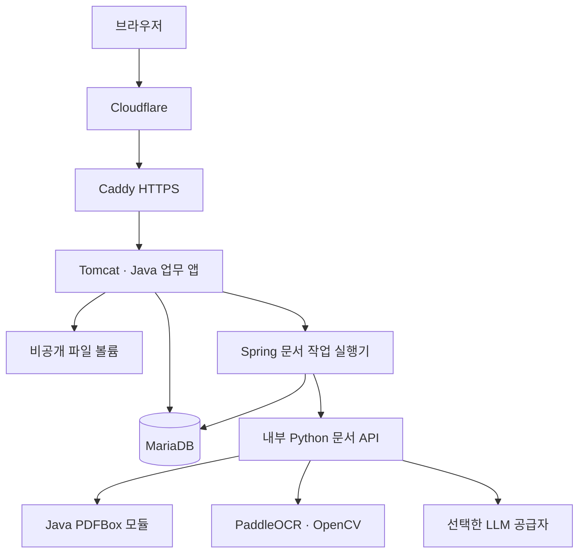
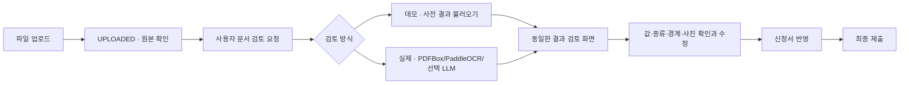

# 지원사업 신청·AI 문서 검토 서비스 아키텍처

갱신일: 2026-10-26. 현재 구현 기준이다. 이전 설계는 [v0.1](아키텍처설계서-보완전-v0.1.md)과 [v0.2 기록](archive/architecture-v0.2.md)에 보존한다.

## 서비스 범위

가상 소상공인 지원사업 6종의 공고 탐색, 직접 신청서 작성 또는 작성 문서 업로드, 문서 검토·수정·반영, 제출·배정·보완·결과 확인을 제공한다. 실제 정부 접수·실명 인증·자격 조회·지원금 지급은 제공하지 않는다. 공개 계정은 여러 방문자가 공유하며 실제 개인정보를 입력하지 않도록 안내한다.

## 기술과 책임

| 구분 | 현재 선택과 책임 |
| --- | --- |
| 업무 서버 | Java 21, eGovFrame 5.0.2, Spring MVC 6.2.11, Spring Security 6.5.5 |
| 화면 | JSP/JSTL, KRDS 1.1.0 CSS·아이콘·글꼴, 자체 JavaScript·서비스 CSS |
| DB | MariaDB 11.4 계열, MyBatis Mapper XML, Flyway V1~V12. JPA 미사용 |
| 패키징 | Maven WAR, Tomcat 10.1.48. Spring Boot 미사용 |
| 문서 PDF | 별도 Java 17 호환 PDFBox 3.0.8 모듈. 텍스트·좌표·렌더링·이미지 영역·분할 |
| OCR | Python 내부 HTTP API, PaddleOCR 3.3.3/PaddlePaddle 3.3.0, PP-OCRv5 한국어 모델 |
| 사진 후보 | PDF 이미지 영역 및 OpenCV 후보 탐색. 사용자가 포함 여부 확인 |
| LLM | OpenRouter/NVIDIA NIM 어댑터, Gemma 4, 원문 줄·값 검증 및 누락 보완·차이 표시 |
| 운영 | Oracle Ubuntu VM의 Docker Compose, 호스트 Caddy, Cloudflare 프록시·DNS, Fail2ban |

고정 버전의 최종 기준은 `pom.xml`, `pdf-engine/pom.xml`, `ocr/requirements.txt`다. Maven·Python 외부 구성요소와 글꼴 고지는 [THIRD_PARTY_NOTICES.md](../THIRD_PARTY_NOTICES.md)를 따른다. 프레임워크 이용을 공식 인증·정부 운영으로 표시하지 않는다.

## 시스템 구성

브라우저는 OCR 내부 API나 공급자 키에 접근하지 않는다. DB·OCR은 공개 포트를 열지 않고 앱은 호스트 루프백에 바인딩한다. 파일은 인증·소유권·배정 검사를 거쳐 전달한다. AI가 활성화된 실제 검토에서는 추출 문구가 외부 공급자에 전송되며 실제 검토 확인 문구·개인정보 처리방침에 이를 안내한다. 데모에서는 새 외부 호출을 하지 않는다.

## 계층과 모듈

Controller는 HTTP·입력 바인딩·화면을, Service/Policy는 권한·상태·업무 규칙을, Mapper XML은 SQL을 담당한다. Service가 트랜잭션 경계다. 화면에서 버튼을 숨기는 것과 별개로 서버가 소유권과 업무 상태를 확인한다.

- identity: 공개 계정 로그인·세션·역할. 공개 회원가입 화면은 실제 계정을 생성하지 않는다.
- program/application: 공고·신청·제출본·접수번호·중복 제출 제어.
- document/ocr: 증빙 첨부·개별 OCR 작업·추출값 대조·사용자 확인값.
- intake: 작성 문서 업로드·문서 분류·분할·사진·LLM·검토값 반영.
- review/audit: 배정·보완·결과 확정·상태 및 접근 이력.
- maintenance: 정기 자료 초기화·공유 파일 저장·미참조 수거·용량 제한.

과거 데모 공간 데이터 모델과 내부 서비스가 남아 있어도 공개 시나리오 선택 화면을 제공한다는 뜻은 아니다. `/demo`는 삭제되어 404를 반환한다.

## 신청과 문서 처리

공개 화면은 직접 입력과 PDF 한 묶음 업로드를 제공한다. 파일 선택 모달에서는 공고별 가상 스캔 문서를 고르거나 직접 파일을 선택한다. 업로드만으로 인식을 시작하지 않는다.

- 업로드 10MiB/파일, 문서 작업 최대 12쪽을 적용한다. 내부 API의 개별 파일 구성 지원과 공개 UI의 한 묶음 선택을 구분한다.
- 텍스트 PDF는 원문을 읽고, 이미지 페이지는 PaddleOCR로 인식한다. 원본 페이지와 모든 추출 항목·분할 문서·사진을 연결한다.
- LLM은 문서 원문의 종류·항목 후보를 제안한다. 원문 근거가 없는 값은 제외하며 기존 값과 다른 후보는 자동 덮어쓰기하지 않는다.
- 검토 결과 저장은 제출이 아니다. 소유자의 DRAFT에서만 수정·반영하고, 제출 이후 기존 제출본을 변경하지 않는다.
- OCR 검토 데모는 실제 생성해 저장한 결과를 불러오며 시간 기반 단계 표시를 사용한다. OCR 실제 검토는 새 엔진을 실행하고 사전 결과나 과거 실제 결과로 대체하지 않는다.

실제 문서 작업 상태는 UPLOADED → QUEUED/PROCESSING → READY → APPLIED이며 실패는 FAILED로 구분한다. 데모는 사용자 요청 뒤 PROCESSING으로 들어간다. 실제 작업은 claim·임대 기한으로 중복 처리를 제어한다. 만료 수거는 V12 전용 인덱스로 LIVE 작업의 만료 구간만 처리한다. 무조건 재시도하거나 공급자를 자동 전환하지 않는다.

## 업무 상태·SQL·데이터 보존

신청은 DRAFT → SUBMITTED → UNDER_REVIEW → NEEDS_SUPPLEMENT → SUBMITTED 또는 APPROVED/REJECTED 흐름을 따른다. 선정은 실제 지급을 의미하지 않는다. 상태·revision·첨부 연결·감사 기록을 같은 트랜잭션에서 처리한다. 금액은 DECIMAL/BigDecimal, DB 시각은 UTC이며 화면·업무 마감은 한국 시간으로 해석한다.

테이블·컬럼의 최종 기준은 `src/main/resources/db/migration/`이다. 기본 신청·첨부·제출본·검토에 더해 `document_intake`, `intake_source`, `intake_analysis_cache`로 문서 작업과 원본·결과 재사용을 관리한다. 신청자 확인값·제출본과 엔진 결과 캐시는 구분한다. 자세한 제약은 [DB 설계서](05-DB설계서.md)를 따른다.

공개 계정은 제출 후 새 회차를 만들 수 있고 이전 건은 나의 신청에서 조회한다. 한국시간 매일 04:00 기준으로 오래된 공개 계정 신청 자료를 정리한다. 처리 중인 작업은 보호하며 5분 주기로 누락분을 재시도한다. 파일은 SHA-256 내용 주소로 공유하고 참조가 사라진 파일만 보호 기간 후 수거한다. 실제 검토는 새 인식을 실행하지만 동일 내용 파일의 저장은 재사용한다.

## 배포·자원·검증

Oracle 무료 VM(RAM 약 1GB·스왑 4GB)에 앱·DB·OCR 컨테이너를 배치하고 Caddy·Cloudflare로 HTTPS를 연결했다. Fail2ban으로 SSH 실패를 감시한다. 이 구성은 단일 앱 프로세스 기준이며 다중 인스턴스·전체 백업 복구·장시간 부하는 별도 검증 대상이다.

텍스트 PDF의 공개 실제 검토는 103.29초·AI 원문 검증 20건·READY·결과 PNG 200을 확인했다. 스캔 1쪽의 별도 실제 OCR는 111.49초·57줄이었다. 입력과 측정 범위가 다르므로 전체 스캔 처리 시간으로 합쳐 표시하지 않는다. 구체적 증거와 한계는 [31 배포 기록](31-오라클무료서버배포.md), [32 LLM 연동](32-LLM문서해석연동.md), [33 회귀 검증](33-PDFBox전환및회귀검증.md)을 따른다.

## 소스와 공개 범위

`.ref/`, `.local/`, `.tools/`, 비밀 환경 설정·키·임시 출력·빌드 산출물은 Git에서 제외한다. 공개 출처·자체 생성 기록은 `.docs/references/`에 있다. 정부 사이트 캡처와 미사용 공식 상징은 현재 공개 대상에서 제거했다. 라이선스·CSS·미사용 공식 상징 정리는 서버 정적 파일에도 반영했다. 소스 저장소는 같은 이름의 비공개 저장소로 재생성했으며 전체 서버 이미지 재배포는 하지 않았다.
