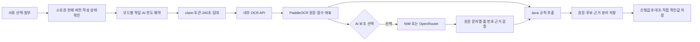

# OCR 및 AI 연동 보고서

작성일: 2026-10-23. 갱신일: 2026-10-26. 이 문서는 실제 구현·로컬 실행 증거와 남은 운영 검증을 구분한다.

## 현재 구현과 초기 기록의 구분

현재 문서 검토는 PDFBox 3.0.8 기반 PDF 원문·렌더링·분할·사진 추출, 스캔의 PaddleOCR 인식, OpenRouter Gemma 4의 문서 전체 항목 해석을 지원한다. OCR 검토 데모는 실제 생성해 저장한 결과를 사용한다. 아래 1~7절의 네 항목 이미지 API는 초기 구현 기록이며, 현재 문서 API와 오라클 후속 결과는 9절 및 29·32·33번 문서를 따른다.

## 1. 초기 이미지 API 구현 범위

PaddleOCR 3.3.3/PaddlePaddle 3.3.0 CPU 추론 API를 eGovFrame 비동기 작업 실행기에 연결했다. 검출 모델은 `PP-OCRv5_mobile_det`, 한국어 인식 모델은 `korean_PP-OCRv5_mobile_rec`다. 모델을 직접 학습하거나 인식 알고리즘을 자체 개발한 것은 아니다.

| 방식 | 입력과 처리 | 외부 전송 |
| --- | --- | --- |
| SAMPLE | 체험 시나리오의 고정 응답 | 없음 |
| LIVE | 첨부 PNG/JPEG → PaddleOCR → Java 라벨·행 위치 규칙으로 네 항목 추출 | 내부 OCR API만 사용 |
| LIVE_AI | 실제 OCR → 외부 AI가 항목 후보 제안 → 원문 근거 확인 → Java 규칙과 대조 | OCR 원문만 선택한 공급자에 전송 |

AI는 필수 기능이 아니다. 상호·등록번호·대표자·개업일 후보를 보조하며 진위·자격·선정·지급을 결정하지 않는다. AI 실패 시 로컬 인식 결과와 수동 확인 흐름을 유지한다. 신청값·정답 JSON·사용자 확인값을 인식기나 AI에 입력하지 않는다.

## 2. 처리 흐름



표의 라벨과 같은 행 오른쪽 영역을 찾아 항목을 추출한다. 등록번호는 숫자 10자리로 정규화하되 앞자리 0을 유지하고 날짜는 실제 달력 유효성을 검사한다. AI가 원문에 없는 값을 만들거나 범위를 벗어난 줄을 지정하면 제외한다. 규칙값과 AI 후보가 다르면 규칙값을 유지하고 확인 필요로 기록한다. 원문에 존재한다는 사실만으로 항목의 의미가 맞다고 보장할 수 없으므로 AI 후보는 항상 사용자가 확인한다.

## 3. 내부 API와 저장 설계

`POST /v1/recognize?assist=false|true`에 정규화한 PNG 본문을 보낸다. 32자 이상의 내부 토큰을 Bearer 헤더로 확인한다. 공개 포트·사용자가 지정한 URL·파일 경로는 받지 않는다. 모델은 시작할 때 한 번 로딩하며 동시에 한 문서만 처리하고 중복 요청은 429로 거절한다.

입력은 최대 10MiB·1천만 픽셀, 출력은 최대 500개 영역·영역당 2천 자다. Java는 응답을 받는 중 1MiB 한도를 적용한다. 내부 오류에 문서 원문·키·공급자 상세 오류를 포함하지 않는다. Java의 전체 호출 제한은 180초이며 AI 공급자 읽기 제한은 최대 120초다.

V3 마이그레이션:

- `ocr_result.evidence`: 항목별 원문·줄 번호·좌표·점수·규칙/AI 출처와 충돌 표시.
- `ocr_result.raw_result`: 인식 모델·패키지 버전·크기·인식 소요 시간·전체 영역·AI 상태.
- `ai_daily_usage`: UTC 날짜·전역/공간별 예약 횟수. 행 잠금과 조건부 갱신으로 동시 요청 한도를 확인한다.

기존 `extracted_fields`와 `field_confirmation`은 유지한다. 모드는 `SAMPLE/LIVE/LIVE_AI`로 작업을 분리하고 최신 작업의 결과만 화면에 표시한다. 확인값을 저장해도 원래 추출값이나 신청 정보를 덮어쓰지 않는다.

로컬 OCR은 최대 3회 시도한다. AI 작업은 중복 외부 호출을 피하기 위해 자동 재시도하지 않으며 실행 중 임대가 만료돼도 실패로 회수한다. 늦게 도착한 결과는 claim 토큰이 일치할 때만 완료 저장한다. AI 한도는 실제 토큰/비용의 회계값이 아닌 요청 예약 수다. 실패한 요청도 예약을 반환하지 않는다.

## 4. 실행과 공급자 전환

Python 3.11 가상 환경에 고정 의존성을 설치한다.

```bash
python3.11 -m venv .tools/ocr-venv
.tools/ocr-venv/bin/pip install -r ocr/requirements.txt
```

`.env.local`에는 AI 공급자 키·모델을 두고 `.env.ocr`에는 아래 내부 설정을 둔다. 두 파일은 Git에서 제외한다. 토큰은 `python3 -c 'import secrets; print(secrets.token_hex(32))'` 등으로 생성한다.

```dotenv
OCR_LIVE_ENABLED=true
OCR_AI_ENABLED=true
OCR_API_URL=http://127.0.0.1:8091
OCR_API_TOKEN=별도로_생성한_32자_이상의_무작위_토큰
AI_PROVIDER=openrouter
```

```bash
./scripts/ocr-dev.sh
# 다른 터미널: 내부 OCR 설정만 앱에 주입한다.
set -a
source .env.ocr
set +a
./scripts/dev.sh
```

`ocr-dev.sh`는 `.env.local` 다음 `.env.ocr`를 읽는다. 따라서 기존 환경 파일을 변경하지 않고 `.env.ocr`에서 실행 공급자를 바꿀 수 있다.

| 설정 | 용도 |
| --- | --- |
| `AI_PROVIDER=nvidia` | NIM 테스트. `NVIDIA_API_KEY`, `NVIDIA_TEXT_MODEL` 사용 |
| `AI_PROVIDER=openrouter` | OpenRouter 연결. `OPENROUTER_API_KEY`, `OPENROUTER_TEXT_MODEL` 사용 |
| `AI_PROVIDER=disabled` | 외부 호출 없음 |
| `AI_TIMEOUT_SECONDS` | 기본 60초, 최대 120초 |
| `AI_LIMIT_PER_DAY` | 체험 공간별 일일 예약 한도, 기본 2회 |
| `AI_LIMIT_GLOBAL_PER_DAY` | 서버 전체 일일 예약 한도, 기본 20회 |

`AI_MODEL`을 지정하면 공급자별 모델명보다 우선한다. 공급자 URL은 코드에서 공식 주소로 제한한다. 가져온 `NVIDIA_BASE_URL`·`AI_FALLBACK_PROVIDER`·`OPENROUTER_SITE_URL`·`OPENROUTER_APP_NAME`은 이 연동에서 사용하지 않는다. 자동 대체 공급자는 없다. 비밀키는 OCR API 프로세스에만 주입하고 브라우저·WAR·공개 이미지에 포함하지 않는다.

## 5. 배포 구성과 경계

```bash
./scripts/test.sh
# .env.ocr에서 AI_PROVIDER=openrouter를 설정한 뒤 실행한다.
docker compose --env-file .env.local --env-file .env.ocr \
  -f compose.yml -f compose.app.yml -f compose.ocr.yml up -d --build
```

앱·MariaDB·OCR 컨테이너를 구성하고 OCR 모델 캐시를 볼륨에 보존한다. OCR 서비스 포트는 호스트에 공개하지 않는다. 기본 앱은 로컬 8088 포트에 바인딩한다. 원격 공개에는 별도 호스트·도메인·HTTPS 프록시·비밀값 주입·용량/백업 정책이 필요하다. 배포 대상은 지정되지 않았으며 원격 운영 배포 완료를 주장하지 않는다.

이 구성은 가상 자료 포트폴리오 체험용이다. 일반 사용자의 실서류를 외부 AI로 처리하는 운영 정책은 별도로 설계해야 한다. Linux ARM64의 PaddlePaddle 3.3.0 wheel은 공식 CPU 패키지 인덱스에서 설치한다. Dockerfile에 공식 추가 인덱스를 지정했다. 초기 모델 다운로드는 네트워크와 디스크를 사용하므로 첫 실행은 시간이 걸릴 수 있다.

## 6. 검증 결과

환경: macOS ARM64·Java 21·MariaDB 11.4, Python 3.11 CPU 추론. 추가로 Linux ARM64 Docker 컨테이너에서 동일 모델을 실행했다. 가상 자료만 사용했다.

| 검증 | 결과 | 증거 |
| --- | --- | --- |
| Java·실제 MariaDB | 30개 성공, 실패·오류·건너뜀 0 | `./scripts/test.sh`, `.local/ocr-java-tests.log` |
| Python API·AI 경계 | 7개 성공 | `.tools/ocr-venv/bin/python -m unittest discover -s ocr`, `.local/ocr-python-tests.log` |
| HTTP 업무 흐름 | 17개 성공 | `scripts/http-smoke.py`, `output/http-smoke.json` |
| 실제 OCR E2E | 기본/비교 두 서류 각 네 항목 정답 대조·불일치 안내·확인값 저장 성공 | `scripts/ocr-smoke.py`, `output/ocr/portal-live-smoke.json` |
| OCR + OpenRouter E2E | 두 서류 각 네 항목 성공, AI 상태 `SUCCEEDED`, 일일 한도 초과 429와 로컬 OCR 지속 확인 | `OCR_SMOKE_MODE=LIVE_AI python3 scripts/ocr-smoke.py`, `output/ocr/portal-live_ai-smoke.json` |
| 실제 브라우저 | 정상 체험 → 신청 저장 → 서류 → LIVE → LIVE_AI → 확인값 저장 → 제출 → 담당 검토 → 가상 선정 → 신청자 결과 조회 성공 | `output/ocr/ocr-ai-screen.png`, `output/ocr/e2e-result-screen.png` |
| Linux ARM64 OCR | 이미지 빌드·모델 초기화·상태 조회·실제 인식 HTTP 200, 문자 27개 영역 | `output/ocr/linux-container-live.json`, `.local/ocr-docker-build.log` |
| 앱 패키지·이미지 | WAR 패키징·Tomcat 이미지 빌드 성공 | `.local/ocr-final-package.log`, `.local/ocr-app-build.log` |
| 배포 구성 | Compose 설정 검증 통과 | `docker compose ... config --quiet` |

브라우저의 결과 확정은 전부 가상 테스트 데이터에 대한 동작이다. 공개 운영 신청의 선정 결정을 AI로 자동 처리한 것이 아니다. `output/`과 `.local/`의 로그·원시 결과는 로컬 검증 자료이며 Git에 포함하지 않는다.

실제 OCR E2E의 기본/비교 인식 시간은 각각 10,566ms/10,150ms였다. OCR+AI E2E의 다른 실행에서 인식 시간은 8,374ms/10,958ms였다. 이 숫자는 AI 응답·큐 대기·전체 HTTP 소요 시간을 포함하지 않는다. Linux ARM64 컨테이너에서는 30,167ms였다. 단건 수치이며 성능 보장이나 P95가 아니다.

### 공급자별 확인

- **OpenRouter**: 가져온 환경 파일의 `google/gemma-4-26b-a4b-it` 모델로 실제 원문 항목 제안 성공. 앱의 LIVE_AI 작업에서도 공급자·모델·성공 상태와 후보를 저장했다.
- **NVIDIA NIM**: `google/gemma-4-31b-it` 모델 조회는 HTTP 200이지만 추론은 30초/120초 제한에서 `TIMEOUT`이었다. thinking 비활성화 요청도 120초 안에 결과를 받지 못했다. 별도 소형 후보는 해당 계정의 추론 경로에서 404였다. NIM 추론 성공을 확인한 것으로 기록하지 않는다.
- NIM 오류에서도 내부 OCR API는 실제 문자 결과와 AI 실패 상태를 함께 반환했다. 운영 공급자는 자동 전환하지 않고 로컬 실행 설정에서 OpenRouter로 명시 전환했다. 기존 `.env.local`은 수정하지 않았다.

키 값이 공개 후보 파일에 포함되지 않았고 `.env.local`·`.env.ocr`가 Git에서 제외됨을 검사했다. 커밋·푸시는 사용자 검토 전까지 보류한다.

### E2E 중 수정한 문제

기존 버전의 실행 컨테이너와 새 앱이 같은 DB의 OCR 작업을 함께 처리하면서 이전 샘플 실행기가 LIVE 작업을 가져가는 충돌을 확인했다. 이전 컨테이너를 중지하고 새 코드만 실행한 뒤, 새 체험 공간에서 모든 실제 OCR·AI E2E를 다시 수행했다. 배포 시 구버전 작업 실행기를 먼저 중지해야 한다. 처리 중인 최신 작업 화면이 과거 성공 결과를 표시하지 않도록 결과 조회도 최신 작업 ID로 한정했다.

## 7. 남은 검증

- 두 가상 사례의 성공은 일반 문서 정확도 지표가 아니다. 독립 문서·훼손/기울기·저해상도·다양한 서식 평가가 필요하다.
- PDF 업로드·페이지 분해·사진 추출·원본 대조는 이후 문서 검토 기능으로 구현했다. 초기 이미지 네 항목 API와 문서 전체 API를 구분한다. 현재 범위는 29·32·33번 문서를 따른다.
- 프로세스 강제 종료·장시간 부하·여러 서버 운영·DB/파일 백업 복구·원격 HTTPS 운영 검증은 별도다.
- 외부 AI의 원문 근거 검증은 의미적 정확성을 보장하지 않는다. 최종 확인은 사용자에게 남긴다.

## 8. 공식 참고 자료

- [PaddleOCR 한국어 모델](https://www.paddleocr.ai/v3.3.0/en/version3.x/algorithm/PP-OCRv5/PP-OCRv5_multi_languages.html)
- [PaddleOCR OCR 파이프라인](https://www.paddleocr.ai/v3.3.0/en/version3.x/pipeline_usage/OCR.html)
- [NVIDIA NIM API](https://docs.api.nvidia.com/nim/reference/llm-apis)
- [OpenRouter Chat Completions API](https://openrouter.ai/docs/api/api-reference/chat/send-chat-completion-request)

- [PaddlePaddle Linux 공식 설치 안내](https://github.com/PaddlePaddle/docs/blob/develop/docs/install/pip/linux-pip_en.md)

## 9. 문서 전체 처리와 오라클 후속 검증

초기 SAMPLE/LIVE/LIVE_AI 표는 이미지 네 항목 API의 당시 계약이다. 현재 문서 검토는 PDFBox로 텍스트·페이지·사진을 추출하고, 스캔은 PaddleOCR로 인식한 뒤 Gemma 4로 문서 전체 항목을 해석한다. OCR 검토 데모는 사전 저장 결과를 사용하며 실제 OCR·LLM을 새로 실행하지 않는다.

Oracle 새 컨테이너에서 텍스트 PDF 6쪽·사진 1개와 실제 OpenRouter 호출(원문 검증 23건), 2쪽 분할, 이미지 PDF 1쪽의 실제 OCR(57줄)을 통과했다. 각각 합산 48.62초와 OCR 111.49초였으며 전체 6쪽 스캔의 시간으로 표시하지 않는다. [33번 검증 기록](33-PDFBox전환및회귀검증.md)을 따른다.

## Java 연동 코드 위치

내부 API 호출은 `integration/ocr/IntakeProvider.java`·`PaddleOcrProvider.java`, 작업 실행은 `scheduler/IntakeWorker.java`·`OcrWorker.java`, 업무 반영은 `service/IntakeService.java`·`OcrService.java`에서 확인한다. 항목·원문 검증은 `service/policy/`, 전달 결과는 `dto/OcrExtraction.java`에 있다. 모두 `src/main/java/kr/co/maeum/support/` 아래 상대 경로다. Python API와 응답 계약은 패키지 정리로 변경하지 않았다.
