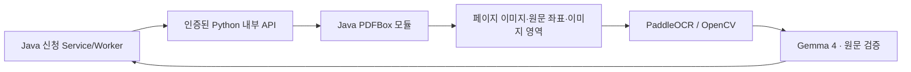

# PDFBox 전환 및 회귀 검증

## 변경 목적

PDF 처리 라이브러리를 Apache PDFBox 3.0.8로 교체했다. PDF 처리는 Java 모듈이 맡고, 문자 인식·사진 후보 탐색·LLM 해석은 기존 Python 내부 API에서 수행한다. 기존 신청 업무와 HTTP 계약을 유지하여 화면과 저장 흐름의 변경 범위를 줄였다.

## 책임과 호출 경로

- `pdf-engine`: 별도 의존성을 가진 Java 모듈. 웹 프레임워크를 끌어오지 않는다.
- `ocr/pdf_document.py`: 모듈 프로세스 실행·임시 파일·페이지 단위 결과 읽기·시간 제한.
- `ocr/document_analyzer.py`: PDFBox 출력으로 기존 필드·분류·사진·표 계약 구성.
- `ocr/api.py`: 기존 `/v1/analyze-document`, `/v1/split-document` 인증 API 유지.
- 샘플 준비 스크립트도 같은 PDFBox 모듈을 사용한다.

PDF 처리를 Python에서 흉내 내거나 브라우저 연출만 바꾼 것이 아니다. 실제 Java PDFBox 코드가 원본을 읽고 렌더링·분할한다. OCR 런타임은 셸 없이 제한된 인자를 전달하는 프로세스 계약으로 모듈을 사용한다. 신청 권한·상태·트랜잭션·SQL은 기존 Service/Policy/Mapper에 유지한다.

## 기존 기능의 보존

| 기능 | 교체 후 구현 |
| --- | --- |
| 원문·좌표 | PDFTextStripper의 TextPosition으로 셀 단위 텍스트와 픽셀 위치 구성 |
| 미리보기 | PDFRenderer로 최대 1600×2400 범위의 RGB 페이지 생성 |
| 사진 영역 | PDFGraphicsStreamEngine으로 이미지 변환 좌표 수집, 렌더링 좌표로 변환 |
| 스캔 사진 | OpenCV 후보 탐색 유지, 원본의 사진 영역을 잘라 저장 |
| 문서 분할 | 선택한 페이지와 순서·리소스·회전을 보존한 PDF 생성 |
| 파일 공유 | 원본과 페이지 선택에서 문서 ID를 고정해 동일 분할의 바이트 재현 |
| 이미지 업로드 | PNG/JPEG 검증 후 PDFBox 이미지 페이지로 처리 |
| 예시 스캔 준비 | PDFBox 렌더링 후 JPEG 페이지로 새 PDF 구성 |

텍스트는 원문이 있는 페이지에만 PDF_TEXT로 표시하고, 스캔 페이지는 실제 PaddleOCR을 호출한다. LLM의 종류 제안은 기존 경계를 자동 변경하지 않는다. 사용자가 원본과 대조하고 반영해야 한다.

## 입력·메모리·프로세스 경계

원본은 10MiB·1~12쪽으로 제한하며 암호화·손상·과도한 페이지 크기·이미지 픽셀을 거절한다. JVM 힙은 128MiB, 렌더링은 페이지 단위, PDFBox 쓰기 캐시는 임시 파일을 사용한다. OCR을 기다리는 동안 PDF 응답 제한 시간을 소모하지 않으며 PDF 결과 읽기에만 120초 제한을 적용한다. 임시 원본은 600 권한이며 성공·실패·중단 경로에서 정리한다.

PDFBox의 프로세스 종료·시간 초과·불완전 출력은 기본 검토 실패 처리로 연결한다. 키·문서 경로·원문을 오류 응답에 포함하지 않는다. 실행 JAR과 임시 파일은 저장소에 넣지 않는다.

## 실행과 배포 구성

- `scripts/build-pdf-engine.sh`: 실행 JAR 빌드.
- `scripts/ocr-dev.sh`: PDF 모듈 빌드 후 기존 OCR API 실행.
- `scripts/test.sh`: PDF 모듈·Java 업무·Python 테스트를 함께 실행.
- `ocr/Dockerfile`: Maven 다단계 빌드와 Java 17 런타임을 포함. Python 패키지에 PyMuPDF를 설치하지 않는다.
- `PDF_ENGINE_JAR`, `PDF_JAVA`: 경로를 바꿔야 하는 환경에서만 지정. 기본값은 로컬 빌드 산출물 또는 컨테이너 환경.
- 캐시 파이프라인 버전: `pdfbox-3.0.8-paddle-v5-ko-layout-v2`.

## 라이선스와 문서

PDFBox·FontBox·pdfbox-io는 Apache License 2.0을 따른다. 실행 JAR 빌드 시 의존 라이브러리의 LICENSE·NOTICE를 병합·보존한다. 이전 PyMuPDF 실행 패키지를 제거했고 소스·샘플 생성·테스트의 import도 교체했다. 기존 설계 기록은 삭제하지 않고 후속 변경으로 연결한다.

## 검증 결과

2026-10-26, 로컬 실제 MariaDB와 가상 문서 기준.

- Java 업무 회귀 66개 통과.
- PDFBox 모듈 3개 통과: 암호화·손상·13쪽 거절, 분할 순서·회전·결정적 바이트, 회전·CropBox의 텍스트·사진 좌표.
- Python 회귀 33개 통과: 7종 텍스트 PDF의 항목·종류·사진·표와 실제 분할 API 포함.
- 이미지 기반 디지털전환 6쪽 PDF: PDFBox → 실제 PaddleOCR → 실제 OpenRouter → READY → 신청서 반영 → 최종 제출 통과.
- 분할 PDF 쪽수: 1·2·1·1·1. 전체 원본 6쪽을 별도로 보존.
- 선택 사진의 신청 첨부 연결 확인.
- 담당자 배정 전 원본·결과 접근 차단, 배정 후 조회 성공 확인.
- 관련 페이지·샘플 18개 경로 HTTP 200 확인. 7종 스캔 샘플 다운로드는 원본 fixture와 SHA-256 일치.
- 사용하지 않는 `/demo` 경로의 실제 404 응답 확인.
- 실제 브라우저에서 신청 내용·서류 분할·사진/표 탭 전환, 모든 이미지 로딩, 프로젝트 소개의 PDFBox 표기 확인.
- 새 스캔 처리의 OpenRouter 결과는 원문 검증 22건·제외 3건·누락 보완 1건·값 차이 3건이었다. 차이를 자동으로 덮어쓰지 않고 기존 값과 함께 표시했다.

표준 출력이 프로토콜인 모듈은 진단 로그와 분리했다. 테스트 결과를 실제 공급자 결과로 대신 표시하지 않는다.

### 당시 로컬 검증 범위의 한계

당시 로컬 Docker 엔진이 응답하지 않아 해당 시점에는 Docker 이미지 검증을 완료하지 못했다. 이후 오라클 컨테이너 검증 결과는 아래 후속 절에 기록한다. 소스와 다단계 빌드 구성 변경을 원격 이미지 배포 완료로 표시하지 않는다. 기존 Oracle 공개 서비스와 Fail2ban은 별도로 기록한 배포 상태를 유지한다.

## 7종 데모 자료 재생성

모든 제공 스캔 문서를 새 PDFBox → 실제 PaddleOCR 경로로 처리하고, OpenRouter의 Gemma 4로 해석한 결과도 사전 저장했다. 데모 요청은 이 결과를 불러오며 OCR·LLM을 새로 호출하지 않는다. 실제 검토와 동일한 원본·분할·사진·AI 원문 대조 화면을 사용한다. 정답을 AI 결과로 주입하지 않았다.

| 자료 | 쪽 | 분할 문서 | 사진 | AI 원문 검증 | 누락 보완 |
| --- | --- | --- | --- | --- | --- |
| access | 6 | 5 | 1 | 18 | 3 |
| comparison | 7 | 5 | 1 | 22 | 4 |
| digital | 6 | 5 | 1 | 22 | 1 |
| energy | 6 | 5 | 1 | 23 | 7 |
| online | 6 | 5 | 1 | 20 | 1 |
| original | 7 | 5 | 1 | 21 | 5 |
| safety | 6 | 5 | 1 | 20 | 3 |

7종 원본 SHA-256, 모든 분할 PDF의 실제 쪽수, 사용 이미지 파일 해시를 확인했다. 기존 생성 자료와 레퍼런스는 삭제하지 않았다.

### 데모·업로드 최종 확인

새 사전 결과를 앱에 반영한 뒤 데모도 UPLOADED 대기 → 명시적 요청 → 단계 표시 → READY → 신청 반영 → 최종 제출까지 확인했다. 실제 검토와 동일한 페이지·분할·사진·AI 대조 화면을 사용하며, 데모의 AI 결과에는 미리 저장한 결과라는 문구를 표시한다.

실제 브라우저에서 공고의 작성 문서 업로드 → 파일 선택 모달 → 미리보기 → 업로드 → 원본 확인 화면을 진행했다. 다음 화면에서도 검토 요청 전 상태를 유지했고, 실제 검토 선택 시 시간 안내 체크가 나타나고 데모로 돌아오면 숨겨지는 것을 확인했다. 페이지 이동 후에도 OCR 검토 데모 배지가 유지되었다. 캡처는 README의 실제 화면 및 로컬 검증 폴더에 보관한다.

### Docker 재확인

로컬 `desktop-linux` 컨텍스트 조회는 성공했지만 `docker version`은 30초 대기 후 시간 초과했다. Docker Unix 소켓에 직접 보낸 `/_ping`도 8초 동안 응답 바이트가 없었다. CLI 실행 여부와 엔진 API 응답을 구분해 확인한 결과이며 원인을 확정한 것은 아니다. 공유 Docker Desktop을 재시작하면 다른 프로젝트 컨테이너도 중단될 수 있어 승인 없이 재시작하지 않았다.

빌드 구성 점검 중 PDF 모듈이 요구하는 `LICENSE` 파일이 Docker 빌드 컨텍스트·COPY에서 빠진 것을 수정했다. 공식 Docker Hub에서 세 기반 이미지 태그와 amd64/arm64 제공을 확인했다. 이는 실제 이미지 빌드 성공을 대신하지 않는다.

## 오라클 컨테이너 실제 검증 — 2026-10-26

로컬 Docker 검증 실패 이후 같은 소스로 Oracle Ubuntu의 별도 컨테이너에서 재검증했다. 기존 공개 앱·DB·OCR은 유지하고 테스트 API는 호스트 루프백에만 연결했다.

| 확인 항목 | 실제 결과 |
| --- | --- |
| 이미지 빌드 | linux/amd64, `maeum-ocr:pdfbox-review-20261026`, 이미지 ID `e90714a71918` |
| 내부 API | 인증 포함 ready, 인증 없는 요청 401 |
| PDF 엔진 | Apache PDFBox 3.0.8 |
| 의존성·고지 | 실행 이미지의 PyMuPDF·fitz 미설치, JAR의 LICENSE·NOTICE 포함 확인 |
| 텍스트 PDF | 6쪽 원문 추출, 사진 1개 확인 |
| 외부 AI | OpenRouter `google/gemma-4-26b-a4b-it`, 성공, 원문 검증 23건·제외 1건 |
| 텍스트 PDF와 AI 합산 | 48.62초. AI 호출만의 시간이 아님 |
| PDF 분할 | 2·3쪽 분할 후 2쪽 재인식 확인 |
| 이미지 기반 PDF | 1쪽 실제 PaddleOCR, 57줄, 111.49초 |

스캔 OCR 요청은 AI 보조를 끈 별도 요청이다. 이미지 기반 전체 6쪽의 원격 처리 시간이나 원격 앱의 전체 신청 E2E 통과로 확대 해석하지 않는다. 테스트 종료 후 별도 컨테이너를 중지해 메모리를 반환했다. 공개 `/login` HTTP 200도 확인했다. 디스크 증설은 하지 않았다.

빌드 중 legacy builder가 `COPY ocr/*.py .`를 거절하여 목적지를 `./`로 수정하고 재빌드했다. 초기 buildx 플러그인 부재와 로컬 디스크 부족 기록은 이전 시점의 실패로 보존한다. 이번 원격 빌드·API 검증 통과로 Docker 런타임 검증을 보완했다. 운영 사이트 반영 결과는 아래 후속 기록으로 구분한다.

## 공개 사이트 확인 중 발견한 DB 잠금 충돌과 수정

첫 공개 검토 데모는 진행률 85%에서 실패했다. MariaDB 교착 기록에서 데모 완료 트랜잭션이 기본키를 잠근 뒤 상태 인덱스를 갱신하는 동안, `expireInterrupted`가 상태 인덱스를 먼저 잠그고 같은 기본키를 기다리는 역순 잠금을 확인했다. 성공 사례로 기록하지 않는다.

만료 수거를 `execution_mode='LIVE'`로 한정하고 `ix_intake_live_expiry(execution_mode,status,lease_until,id)` 인덱스로 조회하도록 수정했다. V12 마이그레이션을 추가하고 기존 `PreparedIntakeIntegrationTest`에 데모 행 잠금 중 만료 수거가 대기하지 않는 회귀 사례를 보완했다.

Oracle의 별도 임시 DB에서 실제 MariaDB 동시 실행을 확인했다. 데모 행을 4초 잠근 상태에서 만료 수거가 먼저 반환했고, 이후 데모는 READY, 만료된 실제 작업만 FAILED, 아직 유효한 실제 작업은 PROCESSING으로 유지됐다. 호출 전체는 Docker 실행 비용을 포함해 2.92초였다. 검증 후 임시 DB를 삭제했다. 새 JUnit 사례의 실행 결과와 이 원격 SQL 검증은 구분한다.

### 운영 반영과 재확인

새 OCR 이미지와 앱 수정 이미지를 운영 Compose에 반영하고 V12까지 적용했다. 첫 수정 후 공개 데모는 작업 4번에서 READY, 결과 이미지 7개 중 확인 요청한 PNG는 200이었다. 빌드와 함께 측정한 완료 시간은 59.11초로, 화면 단계 표시의 의도한 약 12초와 실제 저사양 서버 응답 지연은 구분한다.

첫 실제 검토 작업 5번은 빌드 부하 중 진행됐다. OpenRouter 200 응답은 확인했지만 공개 검증 클라이언트가 상태 조회 중 시간 초과했고 앱 재시작과도 겹쳤으므로 전체 흐름 통과로 기록하지 않는다. 직접 만든 검증 작업만 임대를 만료시켜 정상 만료 수거 대상으로 정리하고, 빌드 종료 후 새 요청으로 재검증한다. 일반 사용자 신청을 일괄 초기화하지 않았다.

### 최종 공개 실제 검토 통과

이미지 생성과 재시작을 끝낸 후 공개 HTTPS에서 다시 검증했다. 로그인 → 공고 6번 → 텍스트 기반 작성 PDF 업로드 → UPLOADED 유지 → 확인 후 LIVE 요청 → READY → 원본·결과 이미지 조회까지 통과했다. 신청 2번의 검토 작업 6번은 103.29초에 완료됐고 결과 이미지 키 7개를 확인했으며 요청한 PNG는 HTTP 200이었다. DB에도 AI 상태 SUCCEEDED와 원문 검증 20건이 저장됐다.

이 103.29초는 텍스트 PDF 전체 앱 처리·AI·분할·결과 조회를 포함하며 스캔 6쪽 OCR 시간으로 표시하지 않는다. 스캔 1쪽의 실제 PaddleOCR는 앞선 별도 컨테이너 검증 111.49초·57줄 결과를 따른다. 최종 앱 이미지는 `57daf2117365`, OCR 이미지는 `e90714a71918`이며 운영 DB는 V12다. 새 잠금 회귀 JUnit 사례는 컴파일을 확인했고, 이번 원격에서 실행한 동시성 검증은 별도 실제 MariaDB SQL 검증이다.
