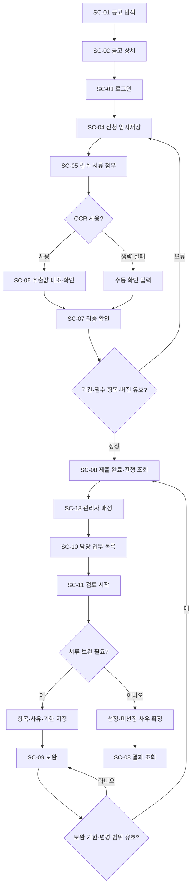
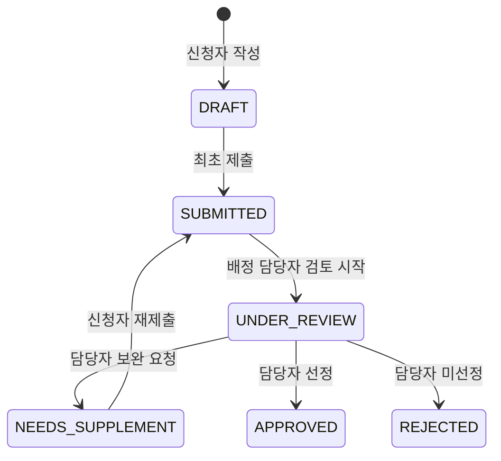
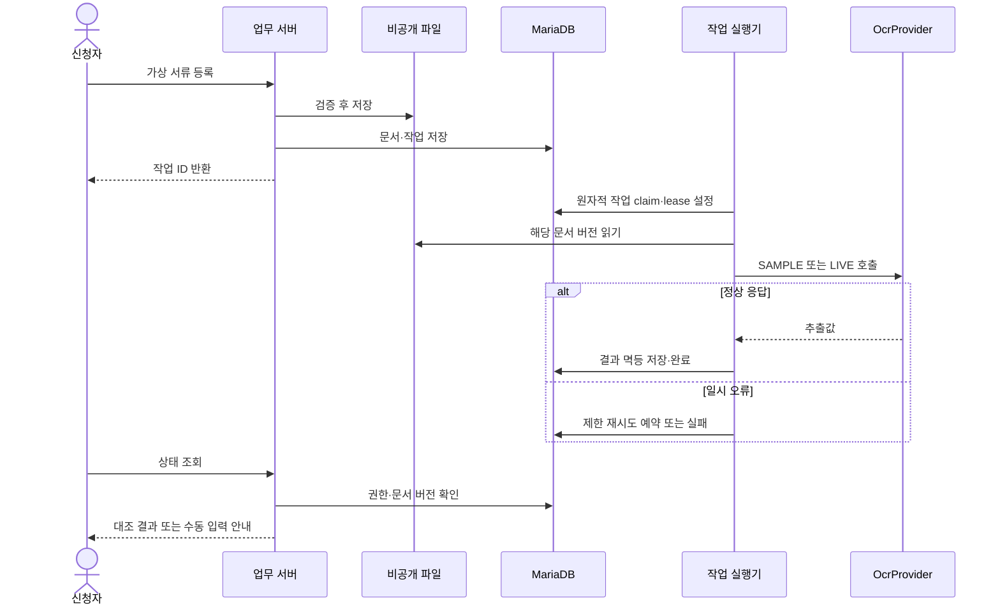
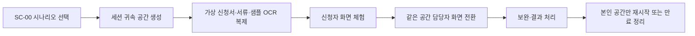

# 업무 흐름도 / Flowchart

> 보존 기록: 본문의 예정·미구현·검토 대기·배포 상태는 작성 당시의 기록이다. 현재 기능과 운영 상태는 원래 번호 문서 및 15·31~33번을 따른다.

> 초기 설계의 범위·수용 기준을 보존한 문서다. 현재 코드와 검증 이력은 [구현 검증 결과](../15-구현검증결과.md), 새 예시 서류와 미연동 범위는 [예시 자료](../17-예시신청서및검증자료.md)를 따른다. 모든 수용 기준이 완료됐다는 뜻은 아니다.

설계 기준 0.1 · 현황 갱신 2026-10-23

## 1. 전체 업무 흐름

## 2. 상태 전이와 책임

보완 요청의 항목이 모두 응답되고 기한 이내일 때만 재제출한다. 상태 전이는 버전 비교·업무 데이터·상태 이력을 한 트랜잭션으로 저장한다. 확정 후 취소·철회·재개방은 범위에 포함하지 않는다.

## 3. OCR 비동기 흐름

오래 걸리는 공급자 호출은 DB 트랜잭션 밖에서 수행한다. lease 회수로 중복 실행 가능하므로 완료 갱신에는 작업 토큰을 비교하고 결과는 job당 1개로 제한한다.

## 4. 데모 흐름

SC-00의 데이터 채우기와 HTML 와이어프레임의 화면 전환은 다르다. 와이어프레임은 DB·인증·OCR을 실행하지 않는다.
