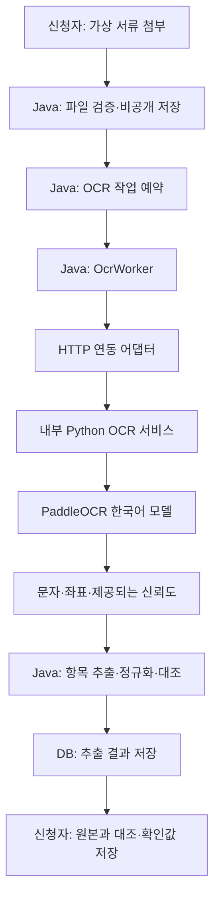

# 문서 OCR 엔진 — 선정 및 연동 계획

> 보존 기록: 본문의 예정·미구현·검토 대기·배포 상태는 작성 당시의 기록이다. 현재 기능과 운영 상태는 원래 번호 문서 및 15·31~33번을 따른다.


작성일: 2026-10-23 · 버전 0.3 · 상태: 예시 자료 2건 제작 현황 반영 / 실제 엔진 연동·비교 실행 전

## 1. 결정 요약

이 프로젝트에서는 **PaddleOCR의 한국어 모델을 우선 검증**한다. EasyOCR과 Tesseract는 같은 평가 자료로 비교할 후보로 둔다. 이는 공식 지원 내용과 현재 서비스 구조에 근거한 우선순위이며, 우리 서류에서 가장 정확한 엔진으로 실측 확정한 결과는 아니다.

이 모듈의 명칭은 **문서 OCR 엔진**으로 정한다. 포트폴리오에서는 **PaddleOCR 기반 문서 인식·검증 엔진**으로 설명하며, 원본 인식 모델과 직접 구현할 처리·검증 코어를 구분한다.

2026-10-23 실제 PaddleOCR 설치·추론·Java/Python 연동을 구현했다. 아래 비교·완료 기준은 초기 계획이며, 최신 실행 증거와 미검증 범위는 [연동 보고서](../19-OCR및AI연동보고서.md)를 따른다.

| 구분 | 현재 상태 |
|---|---|
| 샘플 OCR·작업 상태·사용자 확인값 | 구현됨. 실제 문자 인식은 하지 않음 |
| 실제 OCR 1차 후보 | PaddleOCR 한국어 모델 |
| 비교 후보 | EasyOCR, Tesseract |
| 엔진별 정확도·처리 시간·메모리 | 미측정 |
| 라이브러리·모델·실행 환경 최종 버전 | 연동 검증 단계에서 고정 |
| 관련 요구사항 | FR-013 샘플 OCR, FR-015 실제 OCR, NFR-002 파일·개인정보, NFR-005 작업 복구 |

## 2. 서비스에서 필요한 OCR 범위

사업자등록증 이미지에서 상호·사업자등록번호·대표자·개업일을 추출하고 신청서 내용과 대조한다. 원본, 추출값, 사용자가 확인한 값을 구분해 보여준다.

1차 실제 인식 대상은 **사업자등록증 한 종류, 핵심 항목 네 개**다. 견적서는 현재 필수 첨부·검토 대상이지만, 표와 금액의 자동 추출은 후속 범위다. 손글씨 인식·서류 진위 판정·사업자 실재 조회·자동 지원 자격 판정은 포함하지 않는다.

문자 인식과 업무 항목 추출은 서로 다른 작업이다.

- 문자 인식: 이미지에서 글자와 위치를 읽는 과정.
- 항목 추출: 읽은 글자 중 무엇이 상호·대표자·개업일인지 구분하는 과정.
- 업무 검증: 번호·날짜 형식을 검사하고 신청서와 차이를 확인하는 과정.

OCR 엔진만 붙인 뒤 네 항목을 자동으로 정확히 얻는다고 가정하지 않는다.

## 3. 후보 비교

| 후보 | 공식 자료에서 확인한 내용 | 이 프로젝트에서의 활용 판단 | 확인할 사항 |
|---|---|---|---|
| **PaddleOCR** | 한국어·영어를 지원하는 `korean_PP-OCRv5_mobile_rec` 모델 제공 | 한국어 모델을 명시해 첫 번째로 검증할 후보 | 패키지·추론 런타임 호환성, 검출 모델 조합, 메모리·초기 로딩 시간 |
| **EasyOCR** | Python API, CPU 전용 실행 옵션, 모델을 메모리에 한 번 로드하는 사용법 제공 | 별도 Python 서비스에 연동해 비교할 후보 | 선택 언어·모델 버전, 한글 서류 정확도, CPU 처리 시간 |
| **Tesseract** | OCR 엔진과 한국어 `kor.traineddata` 제공 | 정형 문서를 처리하는 비교 기준 후보 | 이미지 전처리·페이지 분할 설정, 줄 순서와 항목 추출 정확도 |

이 표는 실측 성능 순위가 아니다. 엔진 이름이나 공개 벤치마크의 숫자를 우리 사업자등록증 정확도로 바꾸어 제시하지 않는다. 코드와 모델의 배포 조건은 실제 사용할 버전의 라이선스·고지를 확인해 기록한다.

## 4. PaddleOCR 우선 검토 이유

공식 문서에 한국어 인식 모델과 지원 언어가 명시되어 있어 검증 대상을 구체적으로 고정할 수 있다. 기존 Java 업무 서버는 유지하면서 OCR 실행 환경을 별도 프로세스로 분리하는 구성도 현재의 공급자 인터페이스와 연결할 수 있다.

선정 근거는 다음과 같이 정리한다.

- 한국어·숫자·영문이 함께 등장하는 가상 사업자등록증을 대상으로 검증한다.
- 추출 글자와 좌표를 받아 Java에서 필드 추출·대조 규칙을 관리한다.
- Python 모델 의존성과 Java 업무 의존성을 분리한다.
- 동일 평가 자료로 다른 엔진과 비교하고, 결과가 더 적합하면 선정안을 변경한다.

PP-OCRv5 한국어 모델이 확인된 후보라는 뜻이며, PaddleOCR의 모든 기본 모델이나 후속 세대 모델이 같은 한국어 지원을 제공한다는 뜻은 아니다. 실제 연동 시 인식 모델·검출 모델·옵션을 명시한다.

## 5. 예정 아키텍처



Python 서비스는 OCR 실행만 담당한다. 신청 상태·사용자 권한·선정 여부를 변경하거나 업무 DB에 직접 접근하지 않는다. Java 서버가 요청자의 권한을 검사하고 허용된 문서 버전만 전달한다.

모델은 서비스 시작 시 로드해 요청 간 재사용한다. 요청마다 Python 프로세스를 새로 띄우거나 모델을 다운로드하지 않는다. 첫 모델 확보와 이후 추론 실행을 분리하고, 모델 파일을 준비한 뒤 외부 문서 전송 없이 실행하는 구성을 검증한다.

CPU 환경에서 우선 측정하되 특정 하드웨어에서 원활하게 동작한다고 미리 보장하지 않는다. 현재 개발 기기의 아키텍처와 Linux 배포 이미지에서 패키지 설치·모델 로딩을 각각 확인한다. GPU 도입은 실측 결과가 요구할 때 판단한다.

## 6. 현재 코드와 변경 지점

현재 `OcrProvider`는 다음 계약을 사용한다.

```java
Map<String, String> extract(Document document);
```

이 계약은 샘플 응답처럼 네 항목이 이미 구분된 값을 반환하는 데 맞춰져 있다. 원시 문자·좌표·신뢰도를 유지하려면 **인터페이스와 저장 형식을 함께 확장해야 한다.** 현재 인터페이스만으로 원시 OCR 결과를 모두 표현할 수 있다고 설명하지 않는다.

| 대상 | 예정 변경 |
|---|---|
| `OcrProvider` | 원시 추출 결과를 담는 명시적인 반환 객체로 확장 |
| `SampleOcrProvider` | 새 반환 계약에 맞는 샘플 어댑터로 유지 |
| 실제 OCR 어댑터 | 내부 HTTP 요청·응답 변환·시간 초과·오류 분류 구현 |
| 항목 추출기 | 문자열·좌표에서 네 항목을 구분하는 Java 규칙 분리 |
| `OcrWorker` | 엔진 호출 후 항목 추출·검증·저장 흐름 연결 |
| `ocr_job` | 엔진 모드·패키지/모델 버전·시도 횟수 추적 |
| `ocr_result` | 원시 추출 결과와 업무 필드를 구분하도록 새 마이그레이션 검토 |
| 확인 화면 | 샘플/실제 엔진, 미추출·불일치·사용자 확인 상태 표시 |
| 테스트 | 샘플 회귀·실제 엔진·연동 장애 테스트를 분리 |

반환 객체의 후보 이름은 `OcrExtractionResult`, 개별 텍스트는 `RecognizedText`, 업무 항목은 `ExtractedBusinessFields`로 둔다. 정확한 필드는 구현 시 계약 테스트와 함께 확정한다. 아래 계약 후보는 아직 Java 클래스나 DB 스키마에 반영되지 않았다.

## 7. 내부 API 계약 초안

Python 서비스는 내부 Docker 네트워크에서 Java 서버만 호출하도록 구성한다. 외부 이미지 URL이나 Java 서버의 로컬 경로를 입력받는 API는 제공하지 않는다. Java가 검증한 이미지 바이트를 전달해 두 컨테이너의 파일 경로에 의존하지 않도록 한다.

- 요청 후보: `POST /ocr`, 이미지 multipart 파일과 요청 식별자.
- 응답: 엔진·모델 식별자, 이미지 크기, 텍스트 목록, 좌표, 제공되는 신뢰도, 처리 시간.
- 좌표: 원본 이미지 좌상단을 기준으로 한 픽셀 좌표. 전처리로 크기를 바꾸면 원본 좌표로 환산하는 계약을 명시한다.
- 신뢰도: 제공되지 않으면 `null`. 값의 범위·의미를 어댑터에서 명시하고 엔진 간 같은 척도라고 가정하지 않는다.
- 이미지·응답 크기와 동시 요청 수를 제한한다. 초기에는 모델 실행을 한 번에 한 작업으로 제한한 뒤 측정한다.

다음은 통신 형식을 설명하기 위한 가상 응답이며 실제 엔진 실행 결과가 아니다.

```json
{
  "engine": "paddleocr",
  "modelVersion": "선정 후 고정할 모델 식별자",
  "imageWidth": 1000,
  "imageHeight": 700,
  "texts": [
    {
      "text": "상호: 가상상점",
      "polygon": [[60, 210], [380, 210], [380, 250], [60, 250]],
      "confidence": null
    }
  ],
  "durationMs": 1200
}
```

엔진이 내부적으로 출력한 임의의 파일 경로·예외 원문을 사용자에게 그대로 반환하지 않는다. 초기화 실패와 정상적인 인식 실패는 구분한다.

## 8. 항목 추출·검증 규칙

| 항목 | 처리 방향 |
|---|---|
| 상호 | 상호·법인명 등 표제 주변의 문자와 좌표로 값 후보 탐색. 원래 추출 문자열 보존 |
| 사업자등록번호 | 하이픈·공백을 정리하고 숫자 10자리 형식 검사. 실재·진위 확인으로 표현하지 않음 |
| 대표자 | 대표자·성명 표제 주변에서 후보 탐색. 상호와 혼합된 값을 별도 확인 |
| 개업일 | 지원할 날짜 표기를 정규화하고 실제 날짜 여부·미래 날짜 여부 검사 |

사업자번호의 `O`를 항상 `0`으로 바꾸는 식의 무조건적인 문자 교정은 하지 않는다. 정규화한 값과 원문을 구분하고, 추측한 값으로 사용자의 신청 내용을 조용히 덮어쓰지 않는다.

확신할 수 없는 항목은 미추출 또는 확인 필요로 표시한다. 모델 신뢰도는 사람이 검토할 우선순위에 활용할 수 있지만, 보정 실험 없이 자동 승인 기준으로 사용하지 않는다. OCR 실패 시 직접 입력과 원본 확인 경로를 유지한다.

## 9. 비교 평가 계획

### 평가 자료

사업자등록증 형식의 가상 원본 10개를 준비하고 각각 다음 다섯 조건을 만든다. 총 50개는 **예정 평가 규모**이며 현재 제작·측정 완료한 데이터가 아니다.

1. 정상 이미지.
2. 축소·압축 이미지.
3. 흐림 이미지.
4. 기울어진 이미지.
5. 저대비·그림자 조건 이미지.

문서 배치·상호 길이·번호·날짜 표기를 다양하게 구성한다. 같은 원본의 변형이므로 결과를 독립된 실제 문서 50개의 성능처럼 해석하지 않는다. 추출 규칙 조정에 사용한 자료와 최종 평가 자료를 원본 단위로 분리한다.

현재 UI용 가상 문서는 처음부터 정답 문자열을 알고 만든 자료다. 엔진 연결 확인에는 쓸 수 있지만, 그 자료만으로 실제 사업자등록증 일반화 성능을 주장하지 않는다.

### 지표

| 지표 | 계산·기록 기준 |
|---|---|
| 항목별 정확 일치율 | 항목별 정답과 정확히 일치한 건수 / 해당 항목을 평가한 전체 건수. 미추출·오류도 분모에 포함 |
| 네 항목 전체 일치율 | 네 항목이 모두 일치한 문서 수 / 평가한 전체 문서 수 |
| 문자 오류율 | 정답과 인식 문자열의 삽입·삭제·치환 수를 정답 문자 수로 나눈 값. 계산 라이브러리와 정규화 규칙 기록 |
| 인식·파싱 실패율 | 오류·미추출·기한 초과를 구분하고 누락시키지 않음 |
| 처리 시간 | 모델 로딩, 첫 추론, 예열 후 추론, Java 포함 전체 작업 시간을 분리. 표본 수와 p50/p95 기록 |
| 자원 사용량 | 서비스 시작 후 기본·추론 중 최대 메모리, CPU/GPU와 동시 처리 수 |

엔진 간 동일 이미지·동일 하드웨어·동일 동시 처리 조건을 적용한다. 전처리와 항목 추출 규칙을 다르게 적용했다면 차이를 공개한다. 평가 전에 정규화 규칙과 합격 기준을 고정한다. 처리 시간·메모리 한도는 목표 배포 환경에서 예비 측정 후 수치로 확정한다.

### 기록 양식

| 엔진·모델 | 자료 버전 | 사업자번호 일치율 | 상호 일치율 | 네 항목 전체 일치율 | 예열 후 p95 | 최대 메모리 | 판정 |
|---|---|---|---|---|---|---|---|
| PaddleOCR 한국어 후보 | 미정 | 미측정 | 미측정 | 미측정 | 미측정 | 미측정 | 우선 검증 |
| EasyOCR 후보 | 미정 | 미측정 | 미측정 | 미측정 | 미측정 | 미측정 | 비교 후보 |
| Tesseract + 한국어 데이터 | 미정 | 미측정 | 미측정 | 미측정 | 미측정 | 미측정 | 비교 후보 |

PaddleOCR이 목표 조건을 만족하면 선정한다. 다른 엔진이 더 적합하거나 배포 제약이 크면 그 근거로 결정안을 바꾼다. 엔진의 공개 벤치마크 수치를 이 표의 프로젝트 실측값으로 옮겨 적지 않는다.

## 10. 장애·복구 수용 기준

현재 샘플 작업 실행기의 DB claim·lease·멱등 저장 구조는 재사용한다. 실제 HTTP 연동에는 다음 검증을 추가해야 한다.

- 외부 처리 동안 DB 트랜잭션을 길게 유지하지 않는다.
- 현재 구현은 Java 전체 호출 180초·임대 240초·AI 응답 최대 120초로 제한한다. 연결·응답 시간 제한을 명시하고 단순 대기 무제한 호출을 막는다.
- 재시도는 일시적인 연결·서버 오류만 대상으로 하고 최대 총 3회 시도한다. 잘못된 이미지·지원하지 않는 문서는 반복 호출하지 않는다.
- Java 쪽 시간 초과가 Python 추론 취소까지 보장하지는 않는다. 요청 식별자로 중복 처리·늦은 응답 처리 정책을 정한다.
- 교체 전 서류의 결과는 해당 문서 버전에만 연결하고 현재 결과로 사용하지 않는다.
- 엔진 중단·재시작·모델 로딩 실패·느린 응답·잘못된 응답·마지막 시도 중 프로세스 종료를 시험한다.
- 원본 서류와 OCR 전문을 일반 로그에 출력하지 않는다. 요청 식별자·처리 상태·오류 코드·소요 시간 중심으로 기록한다.

실제 호출의 시간 초과·취소·재시도가 검증되기 전에는 샘플 작업 테스트 통과를 실제 엔진 장애 대응 검증으로 표현하지 않는다.

## 11. 구현 순서와 완료 조건

1. PaddleOCR 한국어 모델과 실행 환경을 고정하고 가상 이미지 한 건으로 독립 추론 확인.
2. Python 서비스에 내부 API·상태 점검·입력 제한을 구성하고 모델을 한 번 로드하도록 검증.
3. Java 반환 객체와 항목 추출기를 설계하고 샘플 어댑터 계약 테스트 보완.
4. 실제 HTTP 어댑터를 연결하고 문서 버전·오류·사용자 확인 흐름 회귀 검증.
5. 동일 자료로 후보를 비교해 엔진 선정 결과와 한계를 기록.
6. 화면에 샘플/실제 엔진을 구분하고 실행·복구 절차와 검증 시나리오를 갱신.

완료 증거는 실제 이미지·정답·엔진/모델 버전·실행 환경·원시 결과·평가 계산·브라우저 확인·장애 테스트 결과다. 실제 엔진 결과를 확인하기 전까지 현재 서비스는 샘플 OCR 상태를 유지한다.

## 12. 엔진 명칭과 제품 내 역할

| 구분 | 명칭·정의 |
|---|---|
| 모듈명 | **문서 OCR 엔진** |
| 기술 설명 | **PaddleOCR 기반 문서 인식·검증 엔진** |
| 역할 | 한글 서류의 문자 인식, 업무 항목 추출, 신청 정보 대조, 원문 근거 및 사용자 확인을 연결하는 문서 처리 모듈 |
| 1차 대상 | 사업자등록증의 상호·사업자번호·대표자·개업일 |
| 서비스와의 관계 | 지원사업 서비스의 문서 처리 모듈. 신청·검토·선정 업무와 인증·권한은 Java 업무 서버가 관리 |
| 현재 단계 | 샘플 작업 흐름 구현 및 실제 인식·검증 코어 설계. 실제 엔진 통합·성능 검증 전 |

‘엔진’은 인식부터 검증·결과 전달까지 책임이 구분된 처리 모듈이라는 의미로 사용한다. PaddleOCR의 인식 알고리즘이나 학습 모델을 직접 개발했다는 의미가 아니다. 독립 제품이나 별도 저장소로 분리하는 작업은 이번 명칭 결정에 포함하지 않는다.

## 13. 직접 개발할 범위와 외부 기술의 경계

| 영역 | 외부 기술 활용 | 이 프로젝트의 개발·검증 책임 |
|---|---|---|
| 문자 검출·인식 | PaddleOCR과 선택한 공식 모델 | 모델·옵션·버전 고정, 입력·출력 어댑터, 추론 환경 검증 |
| 입력 처리 | 이미지·문서 처리 라이브러리 | 형식·크기 검사, 필요한 전처리, 문서 버전·저장 경계 |
| 항목 추출 | 인식된 문자·좌표를 입력으로 사용 | 표제·위치 기반 네 항목 추출, 형식 검사, 원문·정규화값 구분 |
| 정보 대조 | Java 업무 규칙 | 신청값과 추출값 비교, 미추출·불일치 상태, 잘못된 자동 교정 방지 |
| 검토 근거 | OCR 결과의 원문·좌표 | 문서·페이지·영역 연결, 원본 대조, 사용자 확인값과 수정 이력 |
| 비동기 운영 | 현재 작업 실행 구조와 HTTP 통신 | 작업 예약·claim·lease·멱등 저장·재시도·시간 초과·늦은 응답 처리 |
| 품질 평가 | 공통 평가 도구 | 정답 자료·평가 분리·지표 계산·환경 기록·실패 사례 분석 |

현재 구현된 샘플 작업·확인값 저장과 앞으로 개발할 실제 인식 모듈의 상태를 따로 기록한다. 완성 후 기여 설명은 ‘오픈소스 모델을 기반으로 문서 처리·검증 코어를 구현했다’로 표현한다.

## 14. 구현 단계와 검증 시나리오

샘플 비동기 작업 외에 실제 모델 연동·항목 추출·근거 좌표 저장을 구현했다. 독립적인 정확도 평가와 장애 주입 전체 판정은 별도 과제다.

실제 엔진 연동 후 다음 순서로 검증한다.

1. 가상 사업자등록증 첨부와 실제 인식 작업 요청.
2. 상호·사업자번호·대표자·개업일의 추출 결과 확인.
3. 불일치 항목의 원문 영역과 추출값 대조.
4. 원래 추출값과 별도로 확인값 저장·재조회.
5. 흐림·기울어짐·인식 실패 자료에서 직접 입력·재시도 확인.
6. 모델·자료 버전을 고정하고 항목별 정확도·처리 시간·실패 사례 기록.

이 시나리오는 연동 이후의 검증 계획이며 현재 통과 결과가 아니다.

## 15. 실제 엔진 구현·검증 완료 기준

| ID | 완료 기준 | 필요한 증거 | 현재 상태 |
|---|---|---|---|
| OCR-AC-01 | 실제 한국어 모델로 이미지 인식, 샘플/실제 모드 구분 | 버전 고정·모델 로딩·추론 결과·화면 | 미검증 |
| OCR-AC-02 | 네 항목 추출·형식 검사·미추출/불일치 처리 | 정답 대조·번호 앞자리 0·금액/날짜 등 경계 테스트 | 미검증 |
| OCR-AC-03 | 추출값을 원본 문서 버전·페이지·영역과 연결 | 원문 영역 대조·좌표 변환 테스트 | 미검증 |
| OCR-AC-04 | 인식 결과·사용자 확인값·수정 이력 분리 | 저장·재조회·권한·이력 회귀 테스트 | 샘플 확인값 분리는 구현, 실제 엔진 연계 미검증 |
| OCR-AC-05 | 내부 API 계약과 비공개 파일·업무 권한 경계 준수 | Java/Python 계약·크기 제한·다른 공간 접근 차단 테스트 | 기존 업무 권한은 검증, 실제 OCR API 미검증 |
| OCR-AC-06 | 실제 연동의 제한 시간·재시도·늦은 응답·재시작 대응 | 10절의 장애 시나리오 실행 결과 | 샘플 작업 복구는 검증, 실제 호출 미검증 |
| OCR-AC-07 | 같은 평가 자료·조건으로 품질·성능 측정 | 9절 평가 계산·환경·원자료·실패 포함 결과 | 미측정 |
| OCR-AC-08 | 원본 출처·변경 내역·재현 가능한 실행 절차 제공 | 재사용 파일 기록·고정 의존성·실행/복구 안내 | 계획 단계 |

실제 연동만 성공한 상태는 ‘연동 완료’, 정답 대조와 운영 검증을 포함해 위 기준을 충족한 상태는 ‘문서 OCR 엔진 구현·검증 완료’로 구분한다. 현재 서비스 전체의 자동 테스트 통과를 OCR-AC 전체 통과로 간주하지 않는다.

## 16. 문서 관리와 변경 이력

이 문서는 엔진의 명칭·선정 근거·범위·재사용·연동·평가 계획을 관리한다. 실제 구현과 평가가 완료되면 **OCR 엔진 구현 및 성능 검증 보고서**를 별도 작성해 실행 결과와 증거를 기록하고, 이 설계 문서에 연결한다. 현재 실행 결과는 19번 보고서에 기록한다.

| 버전 | 일자 | 변경 내용 |
|---|---|---|
| 0.1 | 2026-10-23 | 후보 비교·PaddleOCR 우선 검토·Java/Python 연동·평가·장애 검증 계획 |
| 0.2 | 2026-10-23 | 문서 OCR 엔진 명칭, 개발 책임, 구현 단계 구분, 완료 기준 추가 |

## 17. 근거 자료

2026-10-23 검토한 공식 자료를 근거로 작성했다. 설치 시점에는 사용할 배포 버전의 문서를 다시 확인한다.

- [PaddleOCR PP-OCRv5 다국어·한국어 모델 안내](https://www.paddleocr.ai/v3.6.0/en/version3.x/algorithm/PP-OCRv5/PP-OCRv5_multi_languages.html): 한국어 인식 모델과 지원 언어.
- [PaddleOCR 공식 저장소](https://github.com/PaddlePaddle/PaddleOCR): 코드·배포·라이선스 확인 진입점.
- [EasyOCR 공식 저장소](https://github.com/JaidedAI/EasyOCR): API, CPU 실행 옵션, 모델 로딩 방식.
- [Tesseract 공식 저장소](https://github.com/tesseract-ocr/tesseract): 엔진·실행 방식.
- [Tesseract 공식 학습 데이터](https://github.com/tesseract-ocr/tessdata): `kor.traineddata`와 한국어 데이터.

관련 프로젝트 문서: [요구사항 명세서](../03-요구사항명세서.md), [DB 설계서](../05-DB설계서.md), [실행 및 운영 안내](../12-실행및운영안내.md), [현재 구현 검증 결과](../15-구현검증결과.md).

## 18. 제작된 평가 준비 자료와 현재 단계

가상상점·가상문구점 정상 사례 각 1건을 제작했다. 각 사례는 같은 서식의 7쪽 묶음이며 개별 페이지를 독립 사업자 7건으로 계산하지 않는다. 가상상점 이미지형 PDF와 두 사례의 200dpi 페이지 이미지는 입력 연결 시험에 활용할 수 있다. 10원본×5조건의 예정 평가셋을 완성한 상태는 아니다.

현재 SampleOcrProvider는 여전히 고정 응답이다. 가상문구점은 코드에서 MISMATCH 시나리오의 반환값으로도 쓰이므로, 새 비교 사례를 기존 시나리오에 단순 연결하면 정상·불일치 의미가 충돌할 수 있다. 사례 데이터와 실패·불일치 시나리오를 분리해 연동해야 한다. PDF 업로드·페이지 변환 API 역시 후속 범위다.

정답·사진·재생성은 17번 문서, 외부 기술의 적용 여부는 루트 THIRD_PARTY_NOTICES.md를 따른다.
