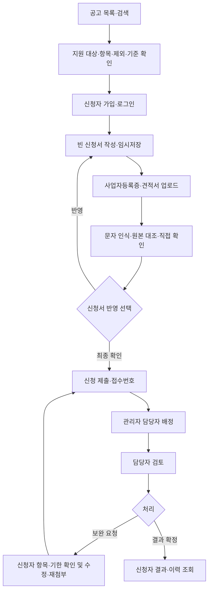

# 신청·검토 업무 개편 및 검증

> 보존 기록: 본문의 예정·미구현·검토 대기·배포 상태는 작성 당시의 기록이다. 현재 기능과 운영 상태는 원래 번호 문서 및 15·31~33번을 따른다.


갱신일: 2026-10-23. 현재 기본 사용 흐름을 설명한다. OCR 공급자 자체의 이전 검증 이력은 19번 문서를 함께 확인한다.

## 서비스의 역할

마음이음은 지원사업 공고·신청·서류 접수·보완·검토 결과를 관리한다. 신청자는 자기 신청을 작성하고, 관리자는 담당자를 배정하며, 담당자는 배정받은 신청을 검토한다. 공고와 서류는 포트폴리오용 가상 정보이며 실제 정부 접수·자격 조회·지원금 지급을 처리하지 않는다.

기본 화면은 회원가입과 신청 업무를 중심으로 구성한다. 신청서와 파일, OCR 작업을 미리 생성하지 않는다. 예시 입력은 사용자가 요청할 때만 실행하고, 서류 예시는 내려받아 직접 첨부하는 작성 보조로 제공한다.

## 역할별 흐름



일반 계정 사이에는 역할 전환 기능이 없다. 담당자와 관리자는 별도 업무 계정으로 로그인한다. 기존 격리 시나리오는 내부 회귀 검증을 위해 보존하며 기본 메뉴나 신청 경로에서는 사용하지 않는다.

## 화면과 입력

| 화면 | 사용자가 하는 일 |
| --- | --- |
| 공고 목록 | 검색어·접수 상태로 공고 확인 |
| 공고 상세 | 대상·항목·제외 사항·검토 기준·기간·한도·서류·문의 정보 확인 |
| 회원가입·로그인 | 신청자 계정 생성·로그인. 공개 가입으로 업무 권한을 선택할 수 없음 |
| 신청서 | 상호·사업자번호·대표자·개업일·연락처·주소·업태·종목·개선 계획·신청금액·자부담 입력 |
| 서류 첨부 | 사업자등록증과 견적서 파일 선택·업로드·미리보기·교체 |
| 서류 확인 | 실제 문자 인식 요청·신청값/인식값/확인값 대조·확인값 저장 |
| 최종 확인 | 사업자·사업장·계획·자부담·총사업비·첨부 확인 후 제출 |
| 나의 신청 | 작성 중인 내용·접수 상태·보완 요청·기한·결과·제출본 조회 |
| 관리자 | 공고 정보 관리·담당자 배정 |
| 담당 접수함 | 배정된 신청 조회·검토 시작·보완 요청·결과 확정 |

신청금액과 자부담의 합을 총사업비로 표시한다. 계산 미리보기는 JavaScript가, 저장·제출 검증과 스냅샷 계산은 Java가 수행한다. 부분 임시저장은 허용하고 제출할 때 필수 항목을 검증한다.

## OCR과 작성 보조의 경계

일반 신청은 실제 인식인 LIVE와 선택적 AI 보조인 LIVE_AI만 요청할 수 있다. 고정 응답 SAMPLE은 일반 계정에서 거절한다. 문자 인식 서버가 비활성화되면 원본을 보고 확인값을 직접 저장할 수 있다.

원본을 확인한 값은 인식 원문과 분리해 저장한다. 확인값을 저장하는 것만으로 신청 정보를 바꾸지 않는다. 별도 ‘신청서에 반영’을 선택할 때 소유권·현재 서류·신청 버전·작성 상태를 검사해 네 항목만 수정한다. 제출 후에는 임의 반영을 허용하지 않는다.

정상 계정의 문자 인식은 사용자별 UTC 날짜 기준 하루 20작업, AI는 `AI_LIMIT_PER_DAY`의 사용자별 한도와 `AI_LIMIT_GLOBAL_PER_DAY`의 전역 한도를 적용한다. 기존 내부 격리 시나리오는 공간별 한도를 유지한다. 이 제한은 비용 회계가 아닌 요청 예약 기준이며 AI가 실패하면 수동 확인이나 로컬 문자 인식을 이용할 수 있다.

예시 정보는 프로젝트의 정답 JSON에서 읽는다. 상호·번호 등을 임의로 조합하지 않고 선택한 사례의 주소·업종·금액·계획도 함께 불러온다. 다운로드는 사전 정의한 두 사례의 두 PNG로 제한하며 사용자 업로드 경로를 공개하지 않는다.

## 저장·권한·유지보수

- 가입 계정은 NORMAL 업무 공간에 속하고 APPLICANT만 부여한다. 비밀번호는 BCrypt로 저장하며 오류 모델에 다시 담지 않는다.
- 같은 업무 공간의 다른 신청자도 남의 신청·파일·확인값을 조회·수정할 수 없다.
- 파일은 비공개 저장소에 두고 PNG/JPEG 검증·10MiB·1천만 픽셀 제한과 정규화를 적용한다.
- V4에서 공고 안내 다섯 항목과 사업장 주소·업태·종목·자부담 컬럼을 추가했다. 총사업비는 파생 값이며 새 제출 스냅샷의 schemaVersion은 2다. 기존 제출본은 변경하지 않는다.
- DB 쿼리는 MyBatis Mapper XML, 업무 검증은 Service/Policy, HTTP 바인딩은 Controller에 유지한다.

## 실행과 검증

일반 업무 화면은 `http://127.0.0.1:8087/`에서 시작한다. OCR 실행 설정은 19번 문서를 따른다. 계정을 가입하고 공고를 선택하면 빈 신청서가 생성된다. 로컬 업무 계정은 12번 문서의 초기 계정 설정을 따른다.

```bash
./scripts/test.sh
./scripts/format.sh --check
.tools/ocr-venv/bin/python -m unittest discover -s ocr -p 'test_*.py'
.tools/ocr-venv/bin/python scripts/service-e2e.py
PORTAL_URL=http://127.0.0.1:8087 python3 scripts/http-smoke.py
```

`service-e2e.py`는 로컬 주소에서만 실행하고 가상 정보를 사용하는 새 일반 계정을 만든다. 관리자·담당자 계정의 초기 비밀번호를 변경했다면 `LOCAL_ACCOUNT_PASSWORD`로 주입한다. 테스트 데이터를 자동 삭제하거나 기존 신청을 초기화하지 않는다.

| 검증 | 결과·증거 |
| --- | --- |
| Java·실제 MariaDB | 36개 통과, 실패·오류·건너뜀 0. `.local/service-rebuild-tests.log` |
| Python OCR·AI 경계 | 7개 통과. `.local/service-python-tests.log` |
| 일반 업무 E2E | 11개 흐름 점검 통과. `output/service/service-e2e.json` |
| 기존 HTTP 회귀 | 17개 통과. `.local/service-regression-http.log` |
| 실제 브라우저 | 일반 회원가입·로그인·공고 상세·직접 입력·두 파일 선택 및 업로드 확인. `output/service/` 화면 자료 |

일반 업무 E2E는 가입 시 관리자 역할을 보내도 신청자만 생성되는지, 빈 신청에서 시작하는지, 두 종류 multipart 업로드, 실제 PaddleOCR 결과, 확인값 반영, 제출, 관리자 배정, 담당 검토, 보완 요청, 새 견적서 업로드·재제출, 결과·제출본 조회를 확인한다. AI 공급자 추론은 19번의 기존 실제 호출 결과와 구분한다.

## 남은 범위

PDF 업로드·견적 세부 항목의 자동 구조화·본인 인증·이메일 확인·비밀번호 재설정·업무 계정 발급 화면은 구현하지 않았다. 담당자·관리자는 로컬 초기 계정으로 검증하며 운영용 계정 발급 절차는 별도다. 공고의 실제 문의처와 정책은 운영기관 연동 시 설정해야 한다. 원격 운영 배포·메일 발송·실제 정부 접수·지원금 지급은 수행하지 않았다.

기존 파일과 DB 데이터를 보존했고 커밋·푸시는 사용자 검토 전까지 보류한다. 단위 테스트 통과와 운영 서비스 완성도를 같은 의미로 사용하지 않는다.
