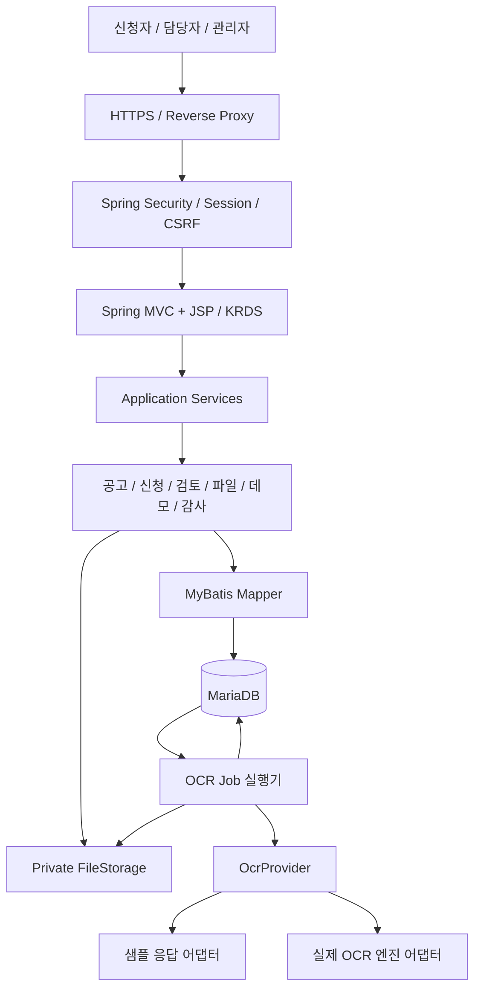
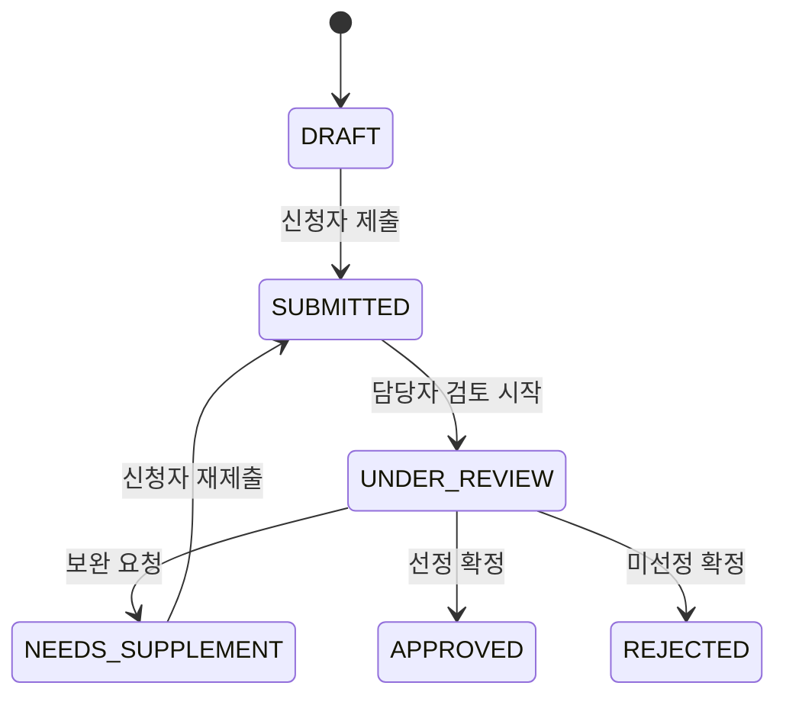

# 이전 아키텍처 v0.2 — 설계 변경 기록

> 보존 기록: 본문의 예정·미구현·검토 대기·배포 상태는 작성 당시의 기록이다. 현재 기능과 운영 상태는 원래 번호 문서 및 15·31~33번을 따른다.


이 문서는 구현 전·초기 설계의 보존본이다. 현재 구조는 [아키텍처 설계서](../09-아키텍처설계서.md)를 따른다. 본문의 예정·미구현·배포 상태는 당시 기록이며 현재 상태가 아니다.

# 지원사업 신청·서류검토 서비스 아키텍처

작성일: 2026-10-23. 버전 0.2. 상태: 설계 기준안과 현재 구현 경계 갱신. 로컬 구현·검증 기록은 15번 문서 참조.

변경 전 문서는 아키텍처설계서-보완전-v0.1.md에 보존했다. 상세 설계는 문서안내.md의 문서 목록을 따른다.

## 1. 목적과 범위

가상의 소상공인 매장 환경개선 지원사업을 대상으로 신청 → OCR 보조 → 접수 → 보완 → 검토 → 선정 결과까지 구현한다. 신청자·담당자·관리자 역할을 제공한다. 1차 범위는 사업 1종, 신청서 1종, 사업자등록증 OCR 1종이다. 실제 자격 조회, 실명인증, 지급·결제, 문자 발송, 심사위원 점수 평가는 후속 범위다.

## 2. 주요 결정

| 항목 | 선택 | 이유 |
|---|---|---|
| 구조 | 단일 배포형 모듈러 모놀리스 | 업무 트랜잭션과 배포를 단순화하면서 모듈 책임 분리 |
| 서버 | Java 21, eGovFrame 5.0 실행환경, Spring MVC | 공공 SI 기술 활용과 업무 계층 설계 |
| 패키징 | Maven, WAR, Jakarta Servlet 6 호환 Tomcat 10.1 계열 | JSP와 서버 렌더링을 명확하게 지원 |
| 화면 | JSP/JSTL, KRDS HTML/CSS/JS, 필요한 부분만 Fetch | 신청·검토 화면 구현에 집중하고 동적 기능 보완 |
| 데이터 | MariaDB, MyBatis, Flyway | SQL·스키마·트랜잭션·마이그레이션을 명시적으로 관리 |
| 인증 | Spring Security, 서버 세션 | 동일 출처 화면과 서버의 인증 단순화, CSRF 방어 |
| 파일 | 비공개 파일 저장소 추상화 | 로컬 볼륨으로 시작하고 객체 저장소로 교체 가능 |
| OCR | OcrProvider 인터페이스 + 샘플/실제 어댑터 | 외부 엔진 종속성 격리와 재현 가능한 데모 |
| 작업 처리 | DB 작업 테이블 + 별도 Spring 관리 실행기 | 초기 메시지 브로커 없이 재시도·재시작 지원 |

eGovFrame 공식 5.0 가이드는 실행환경 JDK 17 이상, 개발환경 JDK 21, Spring 6.2.11, Servlet 5 이상을 안내한다. 본 설계는 Java 21과 Servlet 6을 선택한다. 현재 고정값은 eGovFrame 5.0.2, Spring 6.2.11, Security 6.5.5이며 직접 의존성은 pom.xml을 기준으로 한다. 기존 로컬 WAR 실행 검증 기록은 15번 문서에 있다. 실제 OCR 별도 프로세스는 내부 HTTP로 연동했다. 외부 HTTPS 프록시는 미연동이다. Spring Boot는 초기 구성에 포함하지 않는다.

## 3. 시스템 구성



OCR 실행기는 동일 WAR 프로세스 안의 Spring 관리 컴포넌트다. 브라우저는 OCR 엔진에 직접 접근하지 않는다. 초기에는 애플리케이션 인스턴스 1개를 배포 대상으로 계획하며 다중 인스턴스에서는 세션 공유와 작업 잠금 동작을 추가 검증한다.

## 4. 계층·모듈 규칙

Controller → Service → Domain/Policy + Mapper/Port. Controller에는 HTTP 변환·입력 바인딩을 두고, 권한·상태 전이·마감 검증은 Service와 Policy에서 수행한다. 트랜잭션 경계는 Service다. 화면에서 버튼을 숨기는 것과 별개로 서버가 매 요청의 권한을 검사한다.

- identity: 계정, 역할, 세션, 담당 업무 배정.
- program: 공고, 접수 기간, 필수 서류 종류.
- application: 신청서, 임시저장, 제출 버전, 상태 전이.
- document: 첨부파일, 접근 권한, 파일 버전, 저장소.
- ocr: 작업 예약, 공급자 호출, 결과 파싱·대조, 사용자 확인값.
- review: 검토 항목, 보완 요청·응답, 결과 확정.
- demo: 시나리오 복제, 데모 공간 격리, 만료 정리.
- audit: 업무 변경·파일 열람 이력.
- common: 오류 형식, 공통코드, 페이징. 업무 로직은 넣지 않는다.

모듈 간 변경은 상대 Service를 통해 수행한다. 조회 최적화용 조인은 전용 조회 Mapper로 분리한다.

## 5. eGovFrame 적용 경계

화면처리·공통기반·데이터접근·로깅 실행환경 모듈을 실제로 적용한다. 공식 모듈 식별자를 확인해 Maven에 고정하고, 적용 위치와 사용 근거를 별도 적용표로 남긴다. 공통컴포넌트의 로그인·권한·파일·공통코드 기능은 재사용 후보로 검토하되 전체 소스를 일괄 도입하지 않는다. 재사용한 부분과 직접 만든 업무 코드를 구분하고 출처·라이선스·수정 내역을 기록한다. eGovFrame 적용과 공식 호환성 확인/인증은 구분한다.

## 6. KRDS 화면 설계

| 사용자 여정 | 화면 / 적용 요소 |
|---|---|
| 공고 탐색 | 검색, 필터, 목록, 페이지 이동, 상세 정보 |
| 신청 | 단계 표시, 입력 폼, 도움말, 임시저장, 첨부파일 |
| 서류 확인 | 원본 미리보기, 추출값, 입력값 비교, 확인·수정 |
| 제출 | 오류 요약, 확인 화면, 완료 안내 |
| 진행 확인 | 상태·처리 이력, 보완 요청, 재제출 |
| 담당자 검토 | 검색 목록, 원본·신청 정보 비교, 검토 입력 |

KRDS 공식 HTML/CSS/JS 배포 리소스 버전과 원본 출처를 .ref에 기록하고 제품 템플릿은 별도로 작성한다. 현재 리소스는 다운로드하지 않았다. 디자인 토큰과 공통 JSP 조각으로 헤더·내비게이션·폼 필드·오류·상태 표시를 일관되게 관리한다. 실제 정부 서비스로 오인할 공식 인증 문구나 정부 상징은 사용하지 않고 포트폴리오 데모임을 표시한다.

접근성 수용 기준: 키보드 전 과정 수행, 레이블 연결, 오류 필드 연결과 포커스 이동, 색상 외 상태 구분, 작업 상태 알림, 확대·모바일 재배치. 자동 검사와 실제 브라우저 수동 점검을 함께 기록한다.

## 7. 업무 상태와 동시성



제출 전 필수 항목·필수 첨부·파일 정상 처리·신청 기간을 서버에서 검사한다. OCR 실패 자체로 신청을 막지 않고 수동 확인 입력을 허용한다. 보완 재제출은 별도 보완 기한을 적용한다. 신청 제출 시 버전을 보존하며 기존 서류를 덮어쓰지 않는다. 상태 변경과 이력 기록은 같은 DB 트랜잭션이다. version 컬럼 기반 낙관적 잠금, 중복 제출 키와 DB 제약으로 중복 처리를 차단한다. 마감은 Asia/Seoul 기준으로 명세하고 DB 시각은 UTC로 저장한다. 선정/미선정은 지원금 지급을 의미하지 않는다.

## 8. 주요 데이터

- user, role, user_role, program, staff_assignment
- application: owner_id, program_id, status, version, workspace_id
- application_revision: 제출 당시 신청 정보 스냅샷
- document: 신청·서류 종류·저장 키·해시·MIME·크기·버전
- ocr_job: provider_mode, status, attempts, next_attempt_at, lease_until, error_code
- ocr_result: 서류 버전·추출값·제공되는 경우 confidence·엔진 정보
- field_confirmation: OCR 원래 값과 별개인 사용자 확인값·수정 주체
- review, supplement_request, supplement_item, supplement_response
- application_status_history, audit_event
- workspace, demo_scenario

주요 제약: 사업별 계정당 신청 1건(시연 공간 포함), 저장 키 고유, 서류 버전·해시·공급자 모드별 OCR 작업 중복 방지, 모든 종속 데이터의 신청/데모 공간 귀속 확인. 원문 OCR 응답에는 개인정보가 포함될 수 있어 로그에 남기지 않고 기본적으로 보관하지 않는다. 필요한 정규화 추출값만 권한 통제하여 저장한다.

## 9. OCR 처리

1. 권한·크기·확장자·파일 시그니처를 검사하고 비공개 저장한다. 1차 입력 형식은 PNG/JPEG로 제한한다.
2. 서류 메타데이터와 OCR 작업을 같은 DB 트랜잭션으로 저장한다. 저장 파일과 DB 사이 실패는 보상 삭제 및 고아 파일 정리로 처리한다.
3. 실행기가 작업을 잠금 획득하고 lease를 설정한 뒤, 트랜잭션 밖에서 공급자를 호출한다. HTTP 요청 처리와 긴 DB 트랜잭션 안에서 호출하지 않는다.
4. 추출값을 정규화하고 신청 입력과 비교한다. 신뢰도 미제공을 100%로 취급하지 않는다.
5. 사용자 확인·수정값을 별도 저장한다. 결과는 서류 버전에 연결하고 교체된 서류의 늦은 응답은 현재 결과로 사용하지 않는다.
6. 시간 초과·일시 오류만 제한 횟수로 재시도한다. 실패·프로세스 재시작 시 lease 만료 작업을 회수한다. 공급자 중복 호출 가능성은 있으므로 지원 시 idempotency key를 사용하고 로컬 결과 저장은 멱등 처리한다.

외부 엔진은 미선정이다. 기본 모드는 SAMPLE이며 네트워크 호출 없이 고정 응답을 제공한다. LIVE 모드는 명시적 환경 설정·자격증명·호출 제한을 구성한 후 사용한다. 화면과 작업 데이터에 SAMPLE/LIVE를 함께 표시한다. OCR은 문서 진위나 자격 판정 기능이 아니다.

## 10. 예시 데이터 체험

정상 신청, 상호 불일치, 필수 서류 누락, 보완 요청, OCR 실패의 다섯 시나리오를 제공한다. 가상 신청서와 가상 이미지 서류를 함께 제공하고 테스트용임을 명시한다. 예시 데이터 채우기는 실제 검증·제출·검토 Service를 통과한다.

체험 시작 시 세션에 귀속된 workspace(DEMO)로 원본 fixture를 복제한다. 체험자는 자기 공간 안에서만 신청자/담당자 화면을 전환할 수 있고 실제 관리자 권한은 얻지 않는다. 전역 공유 계정을 바꾸거나 전체 DB를 초기화하는 방식은 사용하지 않는다. 데모 결과와 실제 OCR 검증 결과를 구분한다. 생성 횟수·파일 크기·작업 수를 제한하고 만료된 공간만 정리한다.

## 11. 주요 HTTP 경계

- GET /programs, /programs/{id}: 공고 탐색
- GET/POST /applications: 신청 조회·작성
- POST /applications/{id}/submit: 제출, expectedVersion과 중복 제출 키 사용
- POST /applications/{id}/documents: 첨부 등록
- POST /documents/{id}/ocr-jobs, GET /ocr-jobs/{id}: OCR 요청·상태
- POST /documents/{id}/confirmations: 추출 내용 확인
- GET /staff/applications: 배정 업무 조회
- POST /staff/applications/{id}/supplements: 보완 요청
- POST /staff/applications/{id}/decision: 결과 확정
- POST /demo/workspaces: 체험 시작

모든 변경 요청에 CSRF 검증을 적용한다. 소유권·배정·데모 공간 검증은 파일 다운로드와 OCR 상태 조회에도 적용한다. 역할 변경은 데모 공간에 제한한다. 입력 오류·권한 오류·상태 충돌·OCR 장애를 구분하고 사용자에게 복구 방법을 제공한다.

## 12. 배포와 보안

로컬: 애플리케이션 + MariaDB + 비공개 파일 볼륨. Docker Compose는 후속 구현한다. 배포안: HTTPS 프록시 + Tomcat/WAR + MariaDB + 비공개 영속 저장소. 클라우드 공급자는 미정이다. 인스턴스 재배포 시 DB·파일이 유지되어야 한다.

세션 쿠키는 HttpOnly·Secure·SameSite 설정, 로그인 시 세션 회전, 비밀번호 해시, 실패 횟수 제한을 적용한다. 파일은 웹 루트 밖에 저장하고 서버가 검증한 ID로만 읽는다. 파일 이름을 경로에 직접 사용하지 않으며 다운로드에 안전한 Content-Disposition을 설정한다. 외부 URL을 입력받아 OCR에 전달하지 않는다. 로그는 요청 ID·처리 상태 중심으로 남기며 원문 서류·비밀번호·토큰을 제외한다. 공개 체험은 가상 자료만 허용하며 실제 자료의 외부 전송은 별도 고지·동의 흐름을 갖춰야 한다. 시크릿은 저장소 밖에서 주입한다.

## 13. 예정 디렉터리

```text
.docs/                         설계·화면·검증 문서
.ref/                          공식 참고 출처·버전·수정 이력
src/main/java/.../
  identity/ program/ application/ document/
  ocr/ review/ demo/ audit/ common/
src/main/resources/
  mapper/ db/migration/ messages/
src/main/webapp/
  WEB-INF/views/{public,applicant,staff,demo,fragments}/
  assets/{krds,app}/
src/test/                      업무·통합 테스트
fixtures/                      가상 신청서·서류·OCR 응답
infra/                         로컬 실행·배포 구성
```

현재는 .docs 아래 설계 문서와 검토용 HTML 와이어프레임을 작성했다. 위 애플리케이션 구조는 구현 계획이다.

## 14. 구현 순서와 완료 기준

1. 공식 배포 POM과 KRDS 원본 버전 확정 → 최소 WAR 실행·DB 접속·KRDS 폼을 브라우저에서 확인.
2. 로그인·소유권·공고·신청 임시저장 → 다른 사용자 신청 접근 차단.
3. 첨부·제출·이력 → 누락·마감·중복 제출·동시 수정 테스트.
4. 담당자 검토·보완·선정 → 권한과 허용 상태 전이 통합 테스트.
5. 샘플 OCR·예시 체험 → 5개 시나리오 예상 결과와 공간 격리 확인.
6. 실제 OCR 어댑터 → 가상 이미지로 LIVE 호출·실패·시간 초과를 별도 검증.
7. 접근성·반응형·재시작 복구·배포 점검 → 브라우저 및 HTTP 증거 기록.

현재 검증은 JUnit과 별도 MariaDB 테스트 스키마, HTTP 점검·브라우저 조작으로 구성한다. Testcontainers는 현재 사용하지 않는다. 기존 코드·로컬 실행 검증 기록은 15번 문서에 있으며 최신 실제 OCR 검증은 19번 보고서에 있으며 원격 운영 배포는 미검증이다.

## 15. 공식 근거와 결정 범위

2026-10-23 확인:
- https://www.egovframe.go.kr/docs/5.0/getting-started/ — 실행/개발환경 요구사항.
- https://www.egovframe.go.kr/docs/5.0/egovframe-runtime/ — 실행환경 안내.
- https://egovframe.go.kr/home/main.do — 공식 배포·가이드 진입점.
- https://www.krds.go.kr/html/site/index.html — 스타일·컴포넌트·기본/서비스 패턴.
- https://www.krds.go.kr/html/site/outline/outline_05.html — 공식 리소스 배포 진입점.

모듈러 모놀리스, JSP/WAR, MariaDB, DB 작업 큐 및 데모 공간 설계는 이 프로젝트의 선택이며 공식 필수 구성이라는 뜻이 아니다.

## 16. 업무·SQL·운영 검증 보완 (v0.2)

기본 DB를 MariaDB로 변경하고 SQL·업무 처리·운영 증거를 P0로 강화한다. Oracle은 실제 실행 후에만 지원 여부를 표시하는 P2 항목이다. 신청·보완·결과 업무를 먼저 완성하고 샘플 OCR·데모는 P1, 실제 OCR은 P2로 둔다.

상태별/담당자별 집계·조건 검색·보완 기한 초과 SQL과 실행계획을 남긴다. Linux/Tomcat 배포·로그 분석·재시작·백업 복구·유지보수 사례를 검증한다. JSP/WAR를 유지하며 Boot·jQuery를 기술 목록만 늘리려고 추가하지 않는다. 기존 Java EE 코드와 Jakarta 기반 구성의 차이를 후속 설명한다.

최신 테이블명·컬럼·제약은 05-DB설계서.md, 상세 정책은 03-요구사항명세서.md를 기준으로 한다. 운영 공간도 NOT NULL workspace_id를 사용하고 제출 revision_document와 submission_command로 첨부 불변성·중복 제출을 보강한다.

현재 구현·검증 범위는 [구현 검증 결과](../15-구현검증결과.md)를 참고한다. 본문은 구현 전 설계 기준을 보존한다.

## PDF 처리 모듈 전환 — 2026-10-26

PDF 원문·좌표·렌더링·이미지 영역·분할은 `pdf-engine`의 Apache PDFBox 3.0.8 Java 모듈로 이동했다. Python 내부 API는 페이지 단위 프로세스 계약으로 이 모듈을 사용하고 PaddleOCR·OpenCV·Gemma 4를 조율한다. 기존 Java 신청 Worker와 Python의 HTTP 계약은 유지한다. 메모리·임시 파일·캐시 버전·실제 회귀 증거는 [33번 문서](../33-PDFBox전환및회귀검증.md)에 기록한다.
