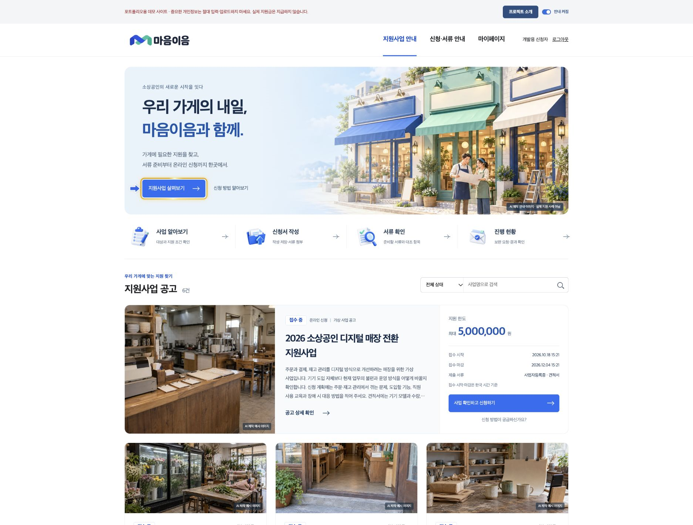
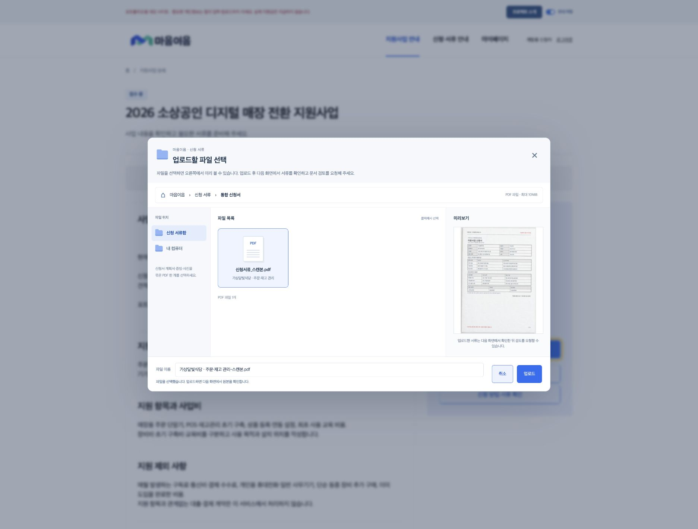
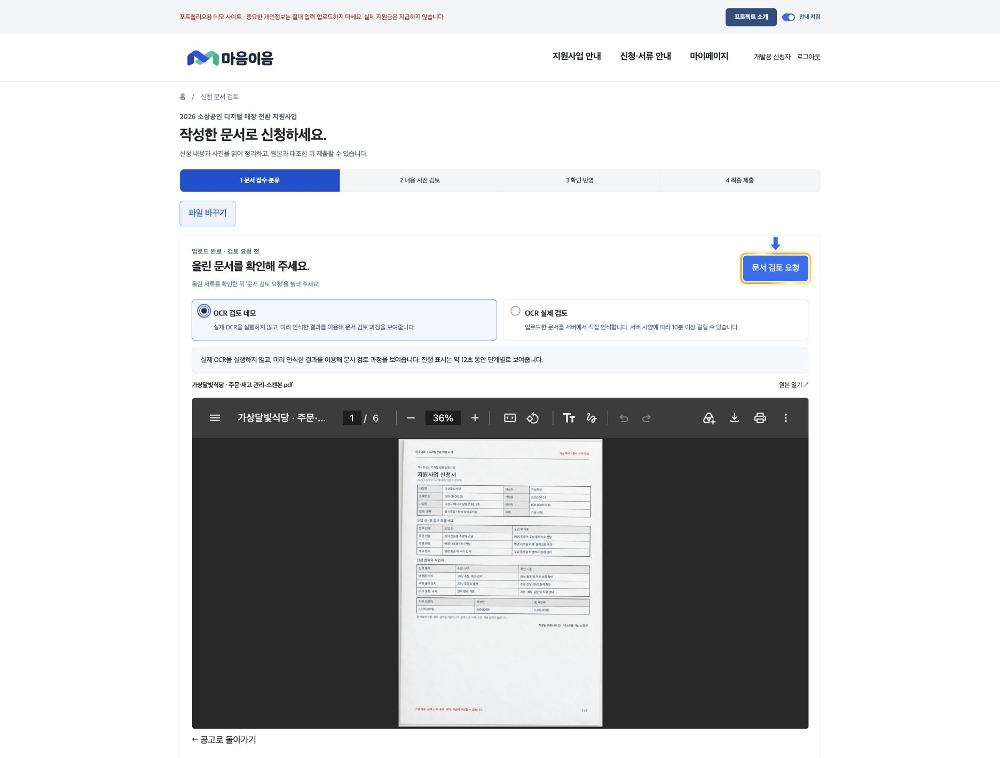
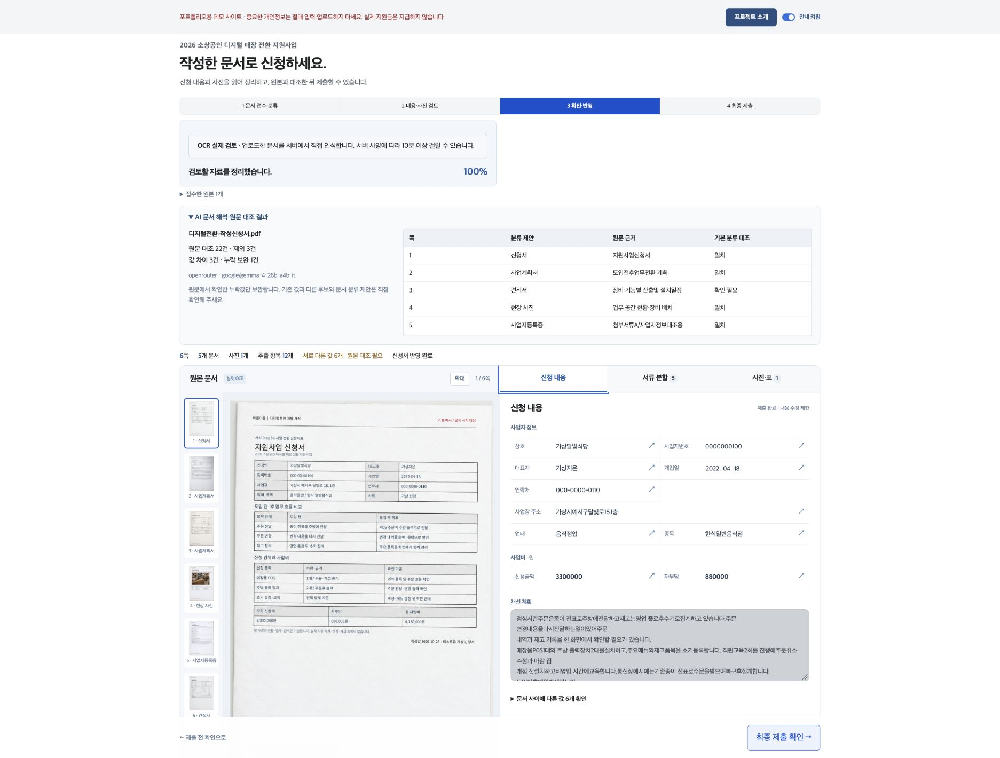
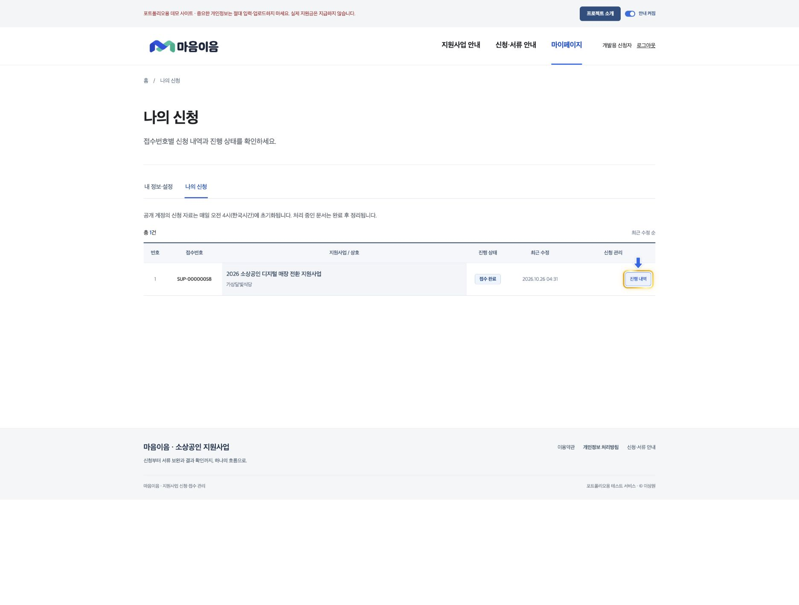
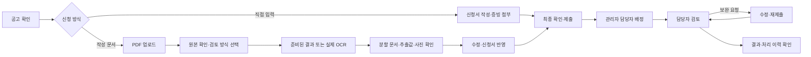
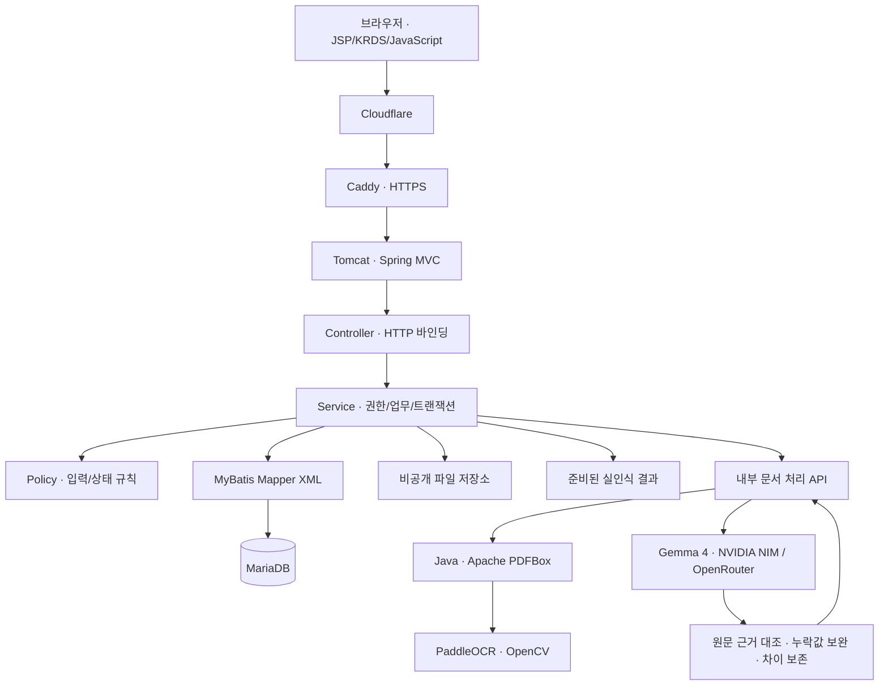
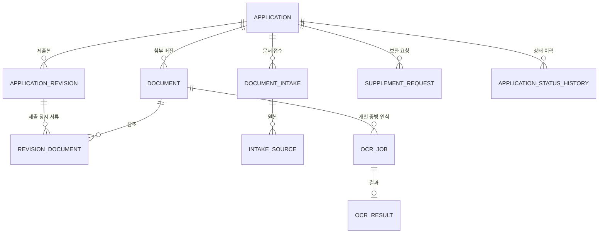
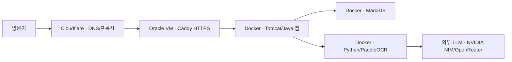

# 마음이음 — 전자정부프레임워크 기반 AI 문서 검토 서비스

### PaddleOCR와 Gemma 4로 신청 문서를 읽고, 접수·검토·보완까지 연결합니다.

**Java 21 · eGovFrame 5.0.2 · Spring MVC · MyBatis · MariaDB · JSP · KRDS 1.1.0**

**PaddleOCR · Gemma 4 · NVIDIA NIM · OpenRouter · Apache PDFBox · OpenCV**

마음이음은 **전자정부프레임워크 기반의 지원사업 신청·AI 문서 검토 서비스**입니다. 신청서와 증빙이 묶인 PDF를 올리면 PaddleOCR로 문자를 인식하고, Gemma 4로 문서 종류와 신청 항목을 해석합니다. 추출한 값은 원문 근거와 대조한 뒤 신청자가 확인·수정해 반영합니다. 접수 이후에는 관리자의 담당자 배정, 담당자의 검토·보완 요청·승인/반려, 신청자의 보완·재제출·결과 조회 기능을 권한별로 제공합니다. 공개 신청자 계정으로 제출한 건이 자동으로 심사되지는 않습니다.

기획·요구사항·화면·DB 설계부터 Java 업무 처리, AI 연동과 운영까지 구현 과정을 함께 기록했습니다.

**[서비스 바로가기](https://maeum.sangwonlee.dev) · [프로젝트 기획](.docs/01-기획서.md) · [설계 문서 모음](.docs/문서안내.md)**

> 포트폴리오용 테스트 서비스입니다. 실제 지원사업 접수나 지원금 지급을 처리하지 않습니다. 공개 계정에는 여러 사람이 접근하므로 실제 개인정보나 민감한 정보를 입력·업로드하지 마세요.

## 실제 화면



| 파일 선택 | 검토 요청 전 원본 확인 |
| --- | --- |
|  |  |

| AI 문서 검토 | 나의 신청 |
| --- | --- |
|  |  |

## 먼저 살펴볼 내용

- **문서를 통한 신청:** 통합 PDF를 업로드하고 신청서·사업계획·증빙 등을 나누어 원본과 추출값을 대조합니다.
- **실제 업무 처리:** 신청·임시저장·제출·담당자 배정·검토·보완·재제출·결과 확인을 Java 서버와 DB에서 처리합니다.
- **이력을 남기는 설계:** 제출본, 첨부 버전, 사용자 확인값과 상태 변경 이력을 구분합니다.
- **동시성·중복 요청 대응:** 행 잠금, 버전 검사, 제출 멱등 키와 업로드 요청 식별자를 사용합니다.
- **운영 제약에 대한 대응:** 저사양 서버의 실제 OCR 시간을 측정하고, 사전 결과 검토와 실제 인식 실행을 구분했습니다.

## 사용 방법

1. 로그인 화면의 **테스트 계정 입력**을 누릅니다.
2. 공개 계정 안내를 읽고 체크한 뒤 로그인합니다. 로그인 후 홈으로 이동합니다.
3. 지원사업 상세에서 **작성 문서 업로드**를 선택합니다.
4. 파일 탐색기 형태의 모달에서 해당 사업의 신청 문서를 선택해 업로드합니다.
5. 다음 화면에서 원본을 확인하고 검토 방식을 선택한 뒤 **문서 검토 요청**을 누릅니다.
6. 신청 항목·문서 분할·사진을 원본과 대조하고 수정한 뒤 신청서에 반영합니다.
7. 최종 제출 후 **나의 신청**에서 접수번호와 상태·이력을 확인합니다.

공개 신청자 계정은 `applicant`입니다. 비밀번호는 화면의 입력 버튼으로 채울 수 있습니다. 회원가입 화면은 신규 계정을 생성하지 않는 입력 화면입니다.

## 문서 검토는 어떻게 작동하나요?

| 방식 | 이번 요청에서 하는 일 | 적합한 경우 |
| --- | --- | --- |
| **OCR 검토 데모** | 실제 OCR을 실행하지 않고, 미리 인식한 결과를 이용해 문서 검토 과정을 보여줍니다. 제공 문서의 바이트 일치를 확인하며, 약 12초 동안 단계별 진행 표시를 보여줍니다. | 방문자가 업무 흐름을 빠르게 확인할 때 |
| **OCR 실제 검토** | 업로드한 문서를 서버에서 직접 인식합니다. 서버 사양에 따라 10분 이상 걸릴 수 있습니다. 기존 인식 캐시를 건너뛰고, 텍스트 PDF는 원문을 읽고 스캔 페이지는 OCR을 수행합니다. | 실제 인식 실행과 결과를 확인할 때 |

OCR 검토 데모의 진행 표시는 **이번 요청의 OCR 실행률이 아닙니다.** 선택 화면·진행 화면·결과 화면에서 이 차이를 안내합니다. 원본 내용이 일치하는 제공 문서에만 준비된 결과를 연결합니다.

실제 OCR도 구현되어 있습니다. 두 검토 방식을 나누기 전의 초기 배포 검증에서, Oracle 무료 서버의 메모리 약 1GB와 스왑 4GB 환경으로 이미지 기반 6쪽 PDF를 처리했습니다. 첫 검토에 약 **14분**, 같은 문서의 기존 결과 재사용에는 약 **6초**가 걸렸습니다. 현재의 실제 OCR 선택은 이 캐시를 건너뜁니다. 이는 검증 당시 한 사례의 측정값이며 처리 시간을 보장하는 수치는 아닙니다. 실제 OCR을 선택할 때는 오래 걸릴 수 있다는 안내를 확인하도록 했습니다.

어느 방식이든 **입력값 수정·신청서 반영·제출·권한 확인·검토 이력은 실제 백엔드 기능**입니다. PaddleOCR의 문자 인식과 Gemma 4의 문서 해석은 별도 단계로 처리합니다.

### PaddleOCR + Gemma 4 문서 처리

PaddleOCR가 이미지 속 글자를 읽고, Gemma 4가 그 내용을 문서 종류와 신청 항목으로 구조화합니다. NVIDIA NIM과 OpenRouter를 같은 문서 해석 계약으로 연동했습니다. 페이지마다 호출하지 않고 문서 전체의 원문을 한 번 전송합니다. 서버가 원문 줄·값·형식을 대조한 뒤 누락 항목만 보완하며, 기존 값과의 차이는 검토 대상으로 보존합니다. 실패해도 기본 인식 결과를 확인할 수 있고, 실패를 AI 처리 완료로 표시하지 않습니다.

| 기술 | 맡은 역할 |
| --- | --- |
| **PaddleOCR · PP-OCRv5** | 스캔 이미지에서 문자와 위치 인식 |
| **Gemma 4** | 문맥에 따른 문서 분류 제안과 신청 항목 구조화 |
| **NVIDIA NIM** | `google/gemma-4-31b-it` 호출 어댑터 |
| **OpenRouter** | `google/gemma-4-26b-a4b-it` 호출 어댑터 |
| **Apache PDFBox 3.0.8** | Java 모듈에서 PDF 원문·좌표 추출, 페이지 렌더링, 사진 영역과 문서 분할 처리 |
| **OpenCV** | 스캔 페이지의 사진 영역 후보 탐색 |

예를 들어 기존 라벨 규칙이 추출하지 못한 ‘경영 주체’, ‘운영 책임자’, ‘요청하는 지원금’ 등의 표현을 Gemma 4로 해석한 테스트에서는 **기본 추출 0개 → 원문으로 검증한 항목 6개**를 확인했습니다. AI를 호출했다는 사실보다 기존 방식에서 놓친 값을 근거와 함께 보완하는 데 초점을 맞췄습니다.

공유 NIM 계정의 40 RPM을 서비스 전용으로 가정하지 않습니다. 기본 6 RPM·동시 1건·호출 간격·429 대기시간을 영속화하고 자동 재시도하지 않습니다. 다른 프로젝트와 같은 예산 저장소를 써야 합산 제한이 가능합니다. [적용 범위와 검증 기록](.docs/32-LLM문서해석연동.md)을 참고하세요.

## 핵심 기능

| 업무 | 구현 내용 |
| --- | --- |
| 지원사업 | 공고 검색·상태 확인, 서로 다른 대상·항목·제외 조건·지원 한도를 가진 가상 공고 6개 |
| 신청 | 직접 입력 또는 작성 문서 업로드, 사업자·사업장·계획·신청금액·자부담 작성과 저장 |
| 문서 접수 | 파일 선택 모달, 업로드 원본 확인, 명시적인 검토 요청, 상태·진행률 조회 |
| AI 문서 해석 | Gemma 4 기반 항목 구조화·문서 분류 제안, 원문 줄 대조, 누락값 보완과 기존 값 보존 |
| 문서 검토 | 문서 종류별 분할 PDF, 쪽별 미리보기, 항목별 원본 근거, 사진 후보·표 행·추출 원문 확인 |
| 사용자 확인 | 추출값 수정, 사진 선택, 문서 경계·종류 수정, 검토 내용의 명시적 신청서 반영 |
| 제출·보완 | 제출 시점의 신청·첨부 스냅샷, 보완 사유·항목·기한, 수정·재제출 |
| 담당 업무 | 관리자 담당자 배정, 담당자의 배정 목록·검토·보완 요청·결과 처리 |
| 이용자 화면 | 마이페이지, 상태별 신청 건수, 표 형태 신청 목록, 신청별 이동 버튼 |
| 운영 | 역할·소유권 검사, 감사 이력, 공통 오류·404 화면, 공개 계정 정기 초기화와 파일 수거 |

## 업무 흐름



업로드만으로 검토를 시작하지 않습니다. 새로고침·뒤로가기·서버 재시작도 사용자의 검토 요청을 대신하지 않습니다.

## 아키텍처



### Java와 전자정부프레임워크

공식 eGovFrame 실행환경 5.0.2를 Maven 의존성으로 사용합니다. `EgovAbstractServiceImpl`, `@EgovMapper` 등 실제 적용 위치와 공식 소스·라이선스 정보를 별도로 기록했습니다. 공식 실행환경이 서비스 계층과 Mapper 등록에 어떻게 적용됐는지 코드와 문서에서 확인할 수 있습니다.

| 계층 | 책임 | 대표 코드 |
| --- | --- | --- |
| PDF 모듈 | PDF 렌더링·좌표·사진 영역·분할 | [PdfEngine](pdf-engine/src/main/java/kr/co/maeum/pdf/PdfEngine.java) |
| Controller | 요청 바인딩, 검증 결과 전달, 화면·리다이렉트 | [IntakeController](src/main/java/kr/co/maeum/support/controller/IntakeController.java) |
| Service | 역할·소유권·상태 검사, 업무 처리, 트랜잭션 | [ApplicationService](src/main/java/kr/co/maeum/support/service/ApplicationService.java), [IntakeService](src/main/java/kr/co/maeum/support/service/IntakeService.java) |
| Policy | 입력·상태·문서 경계의 업무 규칙 | [IntakePolicy](src/main/java/kr/co/maeum/support/service/policy/IntakePolicy.java), [IntakeGroupingPolicy](src/main/java/kr/co/maeum/support/service/policy/IntakeGroupingPolicy.java) |
| Mapper | 바인딩된 SQL과 저장·조회 | [Mapper XML](src/main/resources/mapper) |
| Worker | 실제 인식 작업, 사전 결과 진행 표시, 정기 정리 | [문서 처리](src/main/java/kr/co/maeum/support/scheduler/IntakeWorker.java), [자료 정리](src/main/java/kr/co/maeum/support/scheduler/MaintenanceScheduler.java) |
| View | 화면 출력과 사용자 확인 | [JSP](src/main/webapp/WEB-INF/views), [공통 태그](src/main/webapp/WEB-INF/tags) |

`controller / service / mapper / dto / model`을 중심으로 MVC 계층별 패키지를 구성했습니다. 업무 규칙은 `service.policy`, 작업 실행은 `scheduler`, 외부 OCR 호출은 `integration.ocr`로 분리합니다. 모든 Service에 형식적인 인터페이스를 만들기보다 저장소·공급자처럼 교체가 필요한 경계에 인터페이스를 둡니다. 이름·계층·예외·주석 규칙은 [코드 컨벤션](.docs/11-코드컨벤션.md)을 따릅니다.

### KRDS와 화면 설계

KRDS 1.1.0의 공식 리소스를 바탕으로 색상·입력·버튼·안내·상태 표현을 구성하고, 서비스별 CSS와 JavaScript를 구분했습니다. 정부 운영 사이트 조사와 화면 기준은 [서비스 디자인 규칙](.docs/22-서비스디자인규칙.md)에 남겼습니다.

파일 선택 모달, 원본 뷰어와 좌측 페이지 목록, 추출 항목의 원본 이동, 문서·사진 탭, 목록형 신청 관리 등은 실제 작업 순서에 맞춰 구성했습니다. 안내 화살표와 버튼 강조는 상단에서 끌 수 있습니다. 이 구현을 공인 접근성 인증을 받은 것으로 표시하지 않습니다.

## DB·SQL 설계

JPA 대신 **MyBatis Mapper XML**에 SQL을 작성했습니다. 제출본 조회, 상태별 업무 목록, 보완 항목 대조, 행 잠금과 이력 저장을 SQL 단위로 확인하고 유지보수하기 위한 선택입니다. ORM보다 우수하다는 의미가 아니라 이 프로젝트에서 검증하려는 업무와 맞춘 결정입니다.



전체 관계와 컬럼은 [DB 설계서](.docs/05-DB설계서.md), 실제 스키마 변경은 [Flyway 마이그레이션](src/main/resources/db/migration)에서 확인할 수 있습니다.

- 입력값은 SQL 파라미터로 바인딩합니다.
- 조회와 변경 모두 역할·공간·소유권을 서버에서 검사합니다.
- 상태 변경·제출본·관련 이력은 업무 트랜잭션 안에서 처리합니다.
- 제출 당시 첨부 ID를 연결해, 이후 파일을 교체해도 당시 제출본이 바뀌지 않게 합니다.
- 금액은 `BigDecimal`·`DECIMAL`, 저장 시각은 UTC를 사용하고 한국 시간으로 표시합니다.

[SQL 운영·유지보수 계획](.docs/07-SQL운영및유지보수계획.md) · [프레임워크 적용·SQL 설계](.docs/13-프레임워크적용및SQL설계.md)

## 구현하며 고민한 점

| 문제 | 선택과 이유 | 확인 위치 |
| --- | --- | --- |
| 업로드 후 바로 인식되어 취소·뒤로가기가 불명확함 | 원본 저장과 검토 요청을 `UPLOADED → QUEUED/PROCESSING`으로 분리 | [문서 접수 Service](src/main/java/kr/co/maeum/support/service/IntakeService.java) |
| 중복 클릭·응답 유실로 접수가 여러 번 생김 | 요청 UUID와 내용 해시를 함께 검사해 같은 요청은 재사용하고 내용이 달라지면 거부 | [요청 식별 스키마](src/main/resources/db/migration/V8__intake_request_identity.sql) |
| 보완 후 기존 제출 내용까지 바뀔 수 있음 | 제출 스냅샷과 첨부 버전 연결을 별도로 보존 | [신청 Service](src/main/java/kr/co/maeum/support/service/ApplicationService.java) |
| 동시 저장·제출로 오래된 값이 덮어써질 수 있음 | 행 잠금·버전 검사·멱등 키를 업무 경계에 배치 | [설계 결정 이력](.docs/08-설계결정및변경이력.md) |
| 통합 PDF의 페이지 수와 문서 수가 다름 | 종류·연속 페이지·사용자 경계 수정을 기준으로 묶어 분할 | [문서 그룹 Policy](src/main/java/kr/co/maeum/support/service/policy/IntakeGroupingPolicy.java) |
| OCR 결과가 곧 신청값으로 덮어써질 위험 | 원문·추출 후보·직접 확인값·신청서 반영을 분리 | [OCR/AI 연동 보고서](.docs/19-OCR및AI연동보고서.md) |
| 동일 파일을 계속 저장하면 디스크가 증가함 | 내용 해시 저장과 참조 공유, 미참조 파일 수거 | [저장 공간 관리](.docs/30-자료초기화및저장공간관리.md) |
| 작은 무료 서버에서 인식이 너무 느림 | 실제 수행 시간을 공개하고 사전 결과 검토와 실제 인식을 분리 | [배포 기록](.docs/31-오라클무료서버배포.md) |

[한글 폼 인코딩 유지보수 사례](.docs/14-유지보수사례-한글폼인코딩.md)에는 화면 입력부터 요청 파라미터·DB 저장까지 오류가 생기는 경계를 추적한 과정을 정리했습니다.

## 코드 읽는 순서

신청서 기능은 [ApplicationController](src/main/java/kr/co/maeum/support/controller/ApplicationController.java) → [ApplicationService](src/main/java/kr/co/maeum/support/service/ApplicationService.java) → [ApplicationMapper](src/main/java/kr/co/maeum/support/mapper/ApplicationMapper.java) → [SQL XML](src/main/resources/mapper/ApplicationMapper.xml) 순서로 확인할 수 있습니다. 입력값은 [ApplicationForm](src/main/java/kr/co/maeum/support/dto/ApplicationForm.java), 저장 데이터는 [Application](src/main/java/kr/co/maeum/support/model/Application.java)에 있습니다.

```text
src/main/java/kr/co/maeum/support/
├── controller/       요청·응답·화면 연결
├── service/          업무 처리·트랜잭션
│   └── policy/       입력·상태·문서 처리 규칙
├── mapper/           MyBatis 인터페이스
├── dto/              요청 폼·결과 전달
├── model/            업무 데이터
├── config/           실행·DB·Spring 설정
├── security/         로그인 주체·접근 검사
├── integration/ocr/  OCR API·공급자 연결
├── scheduler/        백그라운드 작업 실행
├── storage/          비공개 파일 저장
└── common/           공통 예외·변환
src/main/resources/mapper/  SQL XML
src/main/webapp/WEB-INF/    JSP·공통 태그
```

## 문서·검증 데이터

가상 공고 6개는 대상·지원 항목·제외 조건·검토 기준이 다릅니다. 사업별 신청서도 사업계획·예산·사진·견적 내용과 서식 구성을 달리했습니다. 반듯한 텍스트 PDF뿐 아니라 기울기·종이 질감이 있는 이미지 기반 스캔 PDF를 준비해 실제 OCR 입력으로 사용합니다.

사전 결과는 이 제공 문서를 실제 OCR로 처리해 생성합니다. 원본 해시·엔진·모델·생성 시점과 산출물을 보관하고, 입력 파일이 다르면 연결하지 않습니다. 재생성 코드는 [prepare-intake-results.py](scripts/prepare-intake-results.py)에 있습니다.

[예시 신청서·검증 자료](.docs/17-예시신청서및검증자료.md) · [사업별 공고](.docs/23-가상지원사업콘텐츠.md) · [사업별 샘플](.docs/24-사업별신청샘플및검증.md) · [개별 서식·비정형 스캔](.docs/25-개별서식및비정형스캔.md)

## 기획·설계 문서

| 단계 | 문서 |
| --- | --- |
| 문제·대상·범위 | [기획서](.docs/01-기획서.md) |
| 업무 흐름 | [업무 흐름도](.docs/02-업무흐름도.md) |
| 기능과 검증 기준 | [요구사항 명세서](.docs/03-요구사항명세서.md), [검증 계획·추적표](.docs/06-검증계획및추적표.md) |
| 화면·와이어프레임 | [화면 정의서](.docs/04-화면정의서.md), [와이어프레임](.docs/와이어프레임) |
| 데이터 | [DB 설계서](.docs/05-DB설계서.md), [SQL 운영 계획](.docs/07-SQL운영및유지보수계획.md) |
| 아키텍처·변경 이유 | [아키텍처 설계서](.docs/09-아키텍처설계서.md), [설계 결정 이력](.docs/08-설계결정및변경이력.md) |
| 구현 기준 | [코드 컨벤션](.docs/11-코드컨벤션.md), [설계 점검](.docs/10-설계점검결과.md) |
| 실행·검증·운영 | [실행 안내](.docs/12-실행및운영안내.md), [구현 검증](.docs/15-구현검증결과.md), [OCR·AI](.docs/19-OCR및AI연동보고서.md), [배포](.docs/31-오라클무료서버배포.md) |

문서는 시점별 결정과 검증 기록을 포함합니다. 이전 결정이 변경된 경우 [변경 이력](.docs/08-설계결정및변경이력.md)의 후속 항목을 함께 확인할 수 있습니다.

## 배포 환경

**Oracle Cloud 무료 VM에 Docker Compose로 배포하고, Cloudflare 도메인·프록시를 연결했습니다.** PDFBox 3.0.8과 OpenRouter Gemma 4 연동 버전을 운영에 반영했습니다. OCR 검토 데모는 사전 결과를 사용하고 실제 검토만 새 OCR·AI 처리를 요청합니다. Java 애플리케이션, 데이터베이스, OCR 서버는 각각 독립된 컨테이너로 실행합니다. Caddy는 VM 호스트에서 HTTPS와 리버스 프록시를 담당합니다.



| 구성 | 배포 방식과 역할 |
| --- | --- |
| **Oracle Cloud Infrastructure** | Ubuntu 24.04 · VM.Standard.E2.1.Micro · RAM 약 1GB · 스왑 4GB |
| **Docker Compose** | 앱·DB·OCR 3개 서비스의 실행 순서, 상태 검사, 재시작과 자원 제한 관리 |
| **Java 애플리케이션** | Java 21 / Tomcat 10.1 컨테이너에 WAR 배포 |
| **MariaDB 11.4** | 내부 네트워크에서 앱과 연결, DB 데이터를 전용 볼륨에 보존 |
| **문서 인식 서버** | Python/PaddleOCR와 Java 17/PDFBox 모듈을 담은 컨테이너, 내부 인증 API와 모델 캐시 볼륨 |
| **Caddy** | 호스트에서 HTTPS 인증서와 리버스 프록시 처리, 앱의 루프백 포트로 전달 |
| **Fail2ban** | 호스트에서 SSH 로그인 실패 감시·IP 차단, systemd로 자동 시작 |
| **Cloudflare** | `maeum.sangwonlee.dev`의 DNS와 프록시 연결 |
| **파일 저장** | 컨테이너 재생성과 별개인 전용 볼륨, 같은 파일은 내용 해시로 공유 |

### 보안과 운영

- Fail2ban의 SSH 감시를 적용했습니다. 10분 내 로그인 실패 5회에 1시간 차단하며, 테스트 주소로 실제 방화벽 차단·해제를 검증했습니다.

- DB와 OCR 포트를 호스트에 공개하지 않고, 앱 포트는 `127.0.0.1`에만 연결했습니다.
- 내부 OCR API는 인증 토큰을 검증합니다. 공급자 키와 DB 비밀번호는 소스 대신 비공개 환경 설정으로 관리합니다.
- HTTPS 전달 정보를 Tomcat에 반영하고, Secure·HttpOnly 세션 쿠키와 CSRF·역할·소유권 검사를 적용합니다.
- 컨테이너 메모리·로그 크기를 제한하고 공개 계정 신청 자료와 불필요한 파일을 정기 정리합니다.
- 외부 LLM 호출은 문서당 1회, 기본 6 RPM·동시 1건으로 제한하며 429 대기시간을 보존합니다.

[Fail2ban SSH 설정](deploy/oracle/fail2ban-sshd.local) · [배포용 Compose](deploy/oracle/compose.yml) · [앱 Dockerfile](deploy/oracle/Dockerfile) · [OCR Dockerfile](ocr/Dockerfile) · [배포·실행 검증 기록](.docs/31-오라클무료서버배포.md)

## 실행하기

Java 21, Maven, Docker Compose가 필요합니다. 실제 OCR은 별도 Python 환경 또는 OCR 컨테이너를 사용합니다.

```bash
# 공식 실행환경 준비와 로컬 DB·Java 서버 실행
./scripts/dev.sh

# 별도 테스트 DB를 사용하는 회귀 검증
./scripts/test.sh

# Java 포맷 검사
./scripts/format.sh --check
```

로컬 실행 주소는 `http://127.0.0.1:8087`입니다. `.env.example`은 설정 항목을 설명하는 예시이며 실제 값이 아닙니다. 비밀번호와 내부 OCR 토큰, 운영자 공개 문의처는 환경변수로 주입합니다. 실제 키를 소스나 README에 기록하지 않습니다.

[로컬·Tomcat·Docker 실행 절차](.docs/12-실행및운영안내.md) · [OCR 실행 설정](.docs/19-OCR및AI연동보고서.md) · [PDFBox 모듈 실행·검증](.docs/33-PDFBox전환및회귀검증.md) · [저사양 서버 Compose](deploy/oracle/compose.yml)

## 검증 범위

- **Java·실제 MariaDB:** 권한·소유권·상태, 제출·보완·버전, 중복 요청, 파일 공유·수거와 저장 상한을 회귀 테스트합니다.
- **Python API:** 내부 인증, 입력 제한, 인식 경계와 AI 응답 근거를 독립 테스트합니다.
- **PDFBox 전환 회귀:** Java 업무 66개·PDF 모듈 3개·Python 33개, 총 102개 테스트와 스캔 문서의 실제 인식·AI 해석·반영·제출을 확인했습니다. 이후 MVC 패키지 리팩터링에서는 추가 잠금 회귀를 포함한 Java 67개·PDF 모듈 3개·Python 33개, 총 103개가 통과했습니다. [검증 기록](.docs/33-PDFBox전환및회귀검증.md)
- **실제 OCR:** 이미지 기반 스캔 PDF를 PaddleOCR로 처리해 페이지·문서·사진·추출값과 원본 파일 접근을 확인합니다.
- **브라우저:** 로그인 확인 모달, 홈 이동, 업로드 후 대기, 검토 요청과 결과, 화면 배치를 확인합니다.
- **오라클 새 이미지 검증:** PDFBox 3.0.8 기반 linux/amd64 컨테이너에서 텍스트 PDF 6쪽·사진 1개·분할을 확인했습니다. 실제 OpenRouter Gemma 4 해석은 원문 검증 23건이며 PDF 처리와 합산 48.62초, 별도 스캔 1쪽 실제 PaddleOCR는 57줄·111.49초였습니다. 전체 6쪽 스캔 측정과 구분합니다. [실행 기록](.docs/33-PDFBox전환및회귀검증.md)
- **공개 사이트 실제 검토:** 새 배포 후 작성 PDF 업로드 → 요청 전 대기 → 실제 검토 → READY → 결과 이미지 조회를 통과했습니다. 텍스트 PDF의 전체 처리 시간은 103.29초, 저장된 AI 원문 검증은 20건이었습니다. 스캔 전체 처리 시간과 구분합니다.
- **원격 배포:** 공인 HTTPS, 비공개 DB·OCR 포트와 환경 파일 접근 제한을 확인합니다. 새 이미지 검증과 운영 사이트 교체 결과는 [배포 기록](.docs/31-오라클무료서버배포.md)에서 구분합니다.

단위 테스트나 정상 화면만으로 실제 공급자 처리·배포·보안 전체가 검증됐다고 표시하지 않습니다. 실행 시점과 증거는 관련 문서에서 구분합니다.

## 운영과 한계

공개 계정의 신청 자료는 한국시간 매일 오전 4시를 기준으로 초기화합니다. 처리 중인 작업은 완료 후 정리하며, 다른 신청이 참조 중인 공유 파일은 보존합니다. 파일 상한은 기본 512MiB, 디스크 여유 공간은 1GiB를 남기도록 설정했습니다. 로그아웃이나 새 신청이 즉시 삭제를 의미하지 않습니다.

OCR은 오인식할 수 있으므로 원본 대조와 사용자 확인이 필요합니다. 표는 원본의 행 단위 확인을 지원하며, 견적 품목·수량·단가를 정규 업무 데이터로 확정하는 기능은 제공하지 않습니다. 실제 정부기관 연계·사업자 진위 확인·지원금 지급·결제·문자/이메일 자동 알림은 구현 범위에 포함하지 않습니다.

## 출처와 권리

공식 실행환경·KRDS·글꼴·문서 처리 라이브러리와 이미지의 출처·이용 조건은 [Third-party notices](THIRD_PARTY_NOTICES.md)에 정리했습니다. 일부 안내 일러스트와 가상 문서의 사진은 AI로 제작했습니다. 정부기관의 공식 서식·지원 사례로 사용하지 않습니다.

포트폴리오용 테스트 서비스 · © 이상원

## 저장소 공개 전 확인

`python3 scripts/check-publication.py`로 현재 공개 대상 파일의 로컬 전용 경로·비밀값 의심 패턴·라이선스 고지·상대 링크·CSS 자산 참조를 검사합니다. `.ref/` 원본은 로컬에 보존하고 공개 출처 기록은 `.docs/references/`에서 관리합니다. 이 명령은 GitHub에 푸시하거나 배포하지 않습니다. 과거 Git 이력과 이미지 속 문구의 검사는 별도입니다.
